# Workshop 2: Construcción de un Pipeline de Datos Batch Confiable
**Orquestación con Apache Airflow 3, Validación con Great Expectations y Data Warehouse Dimensional en MySQL**
**Sebastian Rojas Herrera**
---

## 1. Problema y Objetivo Analítico
El objetivo de este proyecto es diseñar, implementar y orquestar un pipeline de datos batch confiable que integre dos fuentes de datos heterogéneas:
1. **Métricas de audio y metadatos de Spotify:** Granularidad por canción y género.
2. **Historial de nominaciones y premios Grammy:** Registros históricos de galardones musicales.

El propósito central es **garantizar la calidad de los datos en cada etapa** y transformarlos en un **Data Warehouse dimensional (Esquema Estrella)** que permita responder preguntas analíticas críticas sobre cómo el éxito en la crítica (premios Grammy) se correlaciona con las características acústicas (*danceability*, *energy*, *valence*) y la recepción comercial de los artistas (*popularity*).

---

## 2. Alcance de la Solución (Scope Statement)
El pipeline automatiza el ciclo de vida completo de los datos mediante una **Arquitectura Medallón (Bronce, Plata, Oro)** orquestada con **Apache Airflow 3.1.8**:
* **Extracción Heterogénea:** Ingesta de archivos CSV planos (Spotify) y extracción directa desde una base de datos relacional operativa MySQL (`grammy_source`).
* **Calidad de Datos con Great Expectations (GX 1.x):** Compuertas de calidad automatizadas en la capa Bronce (datos crudos) y Plata (datos preparados). Si se detecta una violación a una regla con severidad **Critical**, el pipeline se detiene de forma preventiva evitando la corrupción del Data Warehouse.
* **Transformación y Cruce:** Deduplicación de canciones, normalización de cadenas, mapeo de ganadores y derivación de dimensiones temporales (décadas).
* **Carga Idempotente:** Carga dimensional en MySQL (`etl_workshop`) mediante claves sustitutas (`_sk`), garantizando que ejecuciones repetidas no generen datos duplicados ni violaciones de integridad referencial.

---

## 3. Requerimientos Analíticos

| Requerimiento Analítico | Datos Requeridos / Origen(es) | KPI(s) Esperado(s) | Granularidad y Justificación |
| :--- | :--- | :--- | :--- |
| **Req 1: Evolución acústica de los ganadores**<br>¿Cómo ha evolucionado el perfil acústico (*danceability* y *energy*) de las canciones ganadoras del Grammy a lo largo de las décadas? | **Spotify:** `track_name`, `artists`, `danceability`, `energy`<br>**Grammys:** `year`, `nominee`, `artist`, `winner` | Promedio de `danceability` y `energy` de canciones ganadoras (`is_grammy_winner=True`) agrupado por década. | **Granularidad:** Por década y canción.<br>**Justificación:** Cruza métricas técnicas de Spotify con la temporalidad histórica y el estatus de victoria provisto por los Grammys (`dim_date` + `fact_tracks`). |
| **Req 2: Géneros predominantes y positividad**<br>¿Qué géneros musicales predominan entre las canciones galardonadas con el Grammy y cuál es su positividad (*valence*)? | **Spotify:** `track_name`, `artists`, `track_genre`, `valence`<br>**Grammys:** `nominee`, `artist`, `winner` | Conteo de pistas ganadoras y promedio de `valence` agrupado por género musical (`genre_name`). | **Granularidad:** Por género musical.<br>**Justificación:** Permite identificar los géneros predilectos por la academia y su carga anímica/emocional (`dim_genre` + `fact_tracks`). |
| **Req 3: Artistas más galardonados y diversificación por género**<br>¿Quiénes son los artistas con mayor número de canciones galardonadas con el Grammy en el catálogo y en qué géneros musicales se distribuyen sus victorias? | **Spotify:** `track_name`, `artists`, `track_genre`<br>**Grammys:** `nominee`, `artist`, `winner` | Conteo de canciones premiadas agrupado por artista y clasificado por género (Top 10 artistas en barras apiladas). | **Granularidad:** Por artista y género musical.<br>**Justificación:** Cruce multidimensional estricto entre dos dimensiones (`dim_artist` y `dim_genre`) conectadas mediante la tabla de hechos (`fact_tracks`), revelando si el éxito histórico es monotemático o transita múltiples estilos musicales. |

---

## 4. Fuentes de Datos
* **Spotify Dataset (`spotify_dataset.csv`):** 114,000 registros de pistas de audio con métricas acústicas calculadas por la API de Spotify (`danceability`, `energy`, `valence`, `popularity`, `track_genre`).
* **Grammys Relacional (`grammy_source` en MySQL):** 4,810 registros históricos de premios y nominaciones Grammy, almacenados y extraídos directamente de la tabla relacional operativa MySQL para simular un ambiente de producción real.

---

## 5. Data Profiling (Perfilamiento de Datos y Evidencia)

El análisis exploratorio de las fuentes operativas reveló los siguientes hallazgos:

### Hallazgos en Spotify (CSV):
1. **Completitud:** Se identificó 1 registro corrupto con valores nulos simultáneos en `artists`, `album_name` y `track_name` (0.0008% del total).
2. **Unicidad:** Se detectaron 24,259 duplicados por `track_id`. Esto ocurre porque una misma canción puede pertenecer a múltiples géneros (`track_genre`). *Decisión de diseño:* Deduplicar por `track_id` seleccionando el registro de mayor popularidad y asignando un género representativo para evitar sesgos por doble conteo.
3. **Dominios numéricos:** Las métricas acústicas (`danceability`, `energy`, `valence`) se encuentran dentro del rango matemático esperado de [0.0 a 1.0].

### Hallazgos en Grammys (MySQL `grammy_source`):
1. **Completitud Crítica:** Existen 6 registros con el campo `nominee` nulo. Al ser el nombre de la obra premiada, representa un fallo de integridad crítico.
2. **Nulos de Negocio:** 38% de valores nulos en la columna `artist`. Esto es esperado por lógica de negocio, ya que ciertas categorías técnicas (producción, ingeniería de sonido, empaque) premian a discos o colectivos y no a un solista.
3. **Consistencia de Victoria:** La columna `winner` contiene exclusivamente valores '1', indicando que la fuente histórica solo registra premios otorgados y no nominaciones no ganadoras.

---

## 6. Riesgos y Reglas de Calidad (Quality Rules Design)

| Rule ID | Capa / Dataset | Atributo(s) | Dimensión | Regla de Calidad | Métrica / Umbral | Severidad | Requerimiento |
| :--- | :--- | :--- | :--- | :--- | :--- | :--- | :--- |
| **RQ-01** | Spotify (Raw) | `track_name`, `artists` | Completitud | No pueden existir nulos en nombres de canciones ni de artistas. | Nulos = 0 | **Critical** | Req 1, 2, 3 |
| **RQ-02** | Spotify (Raw) | `danceability`, `energy`, `valence` | Validez | Las métricas acústicas deben situarse en el dominio matemático de la API de Spotify. | Rango [0.0 - 1.0] | **Critical** | Req 1, Req 2 |
| **RQ-03** | Spotify (Prepared) | `track_id` | Unicidad | Cada canción debe ser única en la capa preparada para evitar sesgos analíticos. | Duplicados = 0 | **Critical** | Req 1, 2, 3 |
| **RQ-04** | Grammys (Raw) | `nominee` | Completitud | Todo premio registrado debe contar con una obra o nominado explícito. | Nulos = 0 | **Critical** | Req 1, 2, 3 |
| **RQ-05** | Grammys (Raw) | `winner` | Consistencia | La columna de victoria debe contener valores consistentes con éxito. | Set: `['1', 1, True]` | **Warning** | Req 1, 2, 3 |
| **RQ-06** | Integración (Prepared) | `artist_id_sk`, `date_id_sk`, `genre_id_sk` | Integridad | Las claves foráneas hacia las dimensiones no deben contener nulos. | Nulos = 0 | **Critical** | Req 1, 2, 3 |

---

## 6.6 Diseño de Great Expectations (GX 1.x Fluent API)

La implementación de calidad utiliza **Great Expectations 1.24+** en modo efímero (`mode="ephemeral"`), lo que permite ejecutar validaciones automatizadas dentro de los contenedores de Airflow sin depender de configuraciones estáticas en carpetas locales que puedan desincronizarse en entornos distribuidos.

### 1. Los 5 Bloques Estructurales de Great Expectations

La arquitectura de validación se organiza de forma estricta en cinco componentes secuenciales:
1. **Data Context (`context`):** El administrador principal en memoria RAM. Es el punto de partida que inicializa y gestiona las fuentes, suites y definiciones de validación durante el ciclo de vida de la tarea de Airflow.
2. **Data Source y Data Asset (`data_source`, `data_asset`):** La conexión a la información. El *Data Source* define a Pandas como motor de ejecución (`add_pandas`), y el *Data Asset* apunta al DataFrame específico que se evaluará, definiendo un lote completo (`add_batch_definition_whole_dataframe`).
3. **Expectation Suite (`suite`):** El contenedor de reglas de calidad. Agrupa las expectativas lógicas atómicas pertenecientes a una etapa específica del pipeline.
4. **Validation Definition (`val_def`):** El enlace estructural. Conecta explícitamente el lote de datos (`BatchDefinition`) con su grupo de reglas (`ExpectationSuite`), declarando qué validaciones aplican a qué dataset.
5. **Checkpoint / Ejecución (`val_def.run`):** El motor de evaluación. Ejecuta las pruebas contra el DataFrame real en memoria, genera el resultado detallado (`ValidationResult`), exporta la evidencia en JSON a `docs/evidence/` y activa la política operativa (detener el flujo ante fallos críticos o registrar advertencias).

---

### 2. Tabla Maestra de Mapeo de Calidad (Reglas vs. Expectativas)

A continuación se detalla el mapeo exacto entre las reglas aprobadas del negocio y los objetos correspondientes en el código de Great Expectations:

| Rule ID | Capa y Objeto Evaluado | Atributo(s) | Expectativa GX (`Expectation`) y Qué Comprueba | Expectation Suite | Validation Definition | Severidad | Política Operativa (Checkpoint) |
| :--- | :--- | :--- | :--- | :--- | :--- | :--- | :--- |
| **RQ-01** | `spotify_raw_asset`<br>*(DataFrame crudo de Spotify)* | `track_name`, `artists` | **`ExpectColumnValuesToNotBeNull`**<br>*Comprueba que ninguna fila contenga valores nulos (`NaN` o `None`) en el título ni en los artistas de la pista.* | `spotify_raw_suite` | `spotify_raw_val_def` | **Critical** | Si nulos > 0: **Detiene el pipeline** inmediatamente (`raise ValueError`). Bloquea downstream. |
| **RQ-02** | `spotify_raw_asset`<br>*(DataFrame crudo de Spotify)* | `danceability`, `energy`, `valence` | **`ExpectColumnValuesToBeBetween(min_value=0.0, max_value=1.0)`**<br>*Comprueba que el 100% de las métricas acústicas se encuentren dentro del límite matemático oficial de la API de Spotify.* | `spotify_raw_suite` | `spotify_raw_val_def` | **Critical** | Si hay valores fuera del rango [0.0 - 1.0]: **Detiene el pipeline**. Protege cálculos de promedios. |
| **RQ-04** | `grammys_raw_asset`<br>*(DataFrame crudo desde MySQL)* | `nominee` | **`ExpectColumnValuesToNotBeNull`**<br>*Comprueba que todo premio registrado tenga obligatoriamente una obra, canción o álbum nominado explícito.* | `grammys_raw_suite` | `grammys_raw_val_def` | **Critical** | Si nulos > 0: **Detiene el pipeline**. Es el interruptor probado en el fallo controlado de la **Prueba B**. |
| **RQ-05** | `grammys_raw_asset`<br>*(DataFrame crudo desde MySQL)* | `winner` | **`ExpectColumnValuesToBeInSet(value_set=['1', 1, True, 'True'])`**<br>*Comprueba que el indicador de victoria solo contenga representaciones positivas de éxito.* | `grammys_raw_suite` | `grammys_raw_val_def` | **Warning** | Si aparecen otros valores: **Registra alerta en logs y JSON**, pero el pipeline continúa según política. |
| **RQ-03** | `prepared_asset`<br>*(DataFrame integrado en Capa Plata)* | `track_id_bk` | **`ExpectColumnValuesToBeUnique`**<br>*Comprueba que no exista ninguna pista repetida tras la deduplicación y el cruce.* | `prepared_suite` | `prepared_val_def` | **Critical** | Si duplicados > 0: **Detiene el pipeline**. Evita duplicar métricas en la tabla de hechos. |
| **RQ-06** | `prepared_asset`<br>*(DataFrame integrado en Capa Plata)* | `artist_id_sk`, `date_id_sk`, `genre_id_sk` | **`ExpectColumnValuesToNotBeNull`**<br>*Comprueba que ninguna clave foránea en la tabla de hechos quede nula o huérfana.* | `prepared_suite` | `prepared_val_def` | **Critical** | Si hay llaves nulas: **Detiene el pipeline**. Garantiza integridad referencial estricta en MySQL. |

---

### 3. Diagrama Arquitectónico de Great Expectations (Flujo de Decisión)

El siguiente diagrama detalla cómo los 5 bloques de GX operan de forma orquestada dentro de cada compuerta de validación:

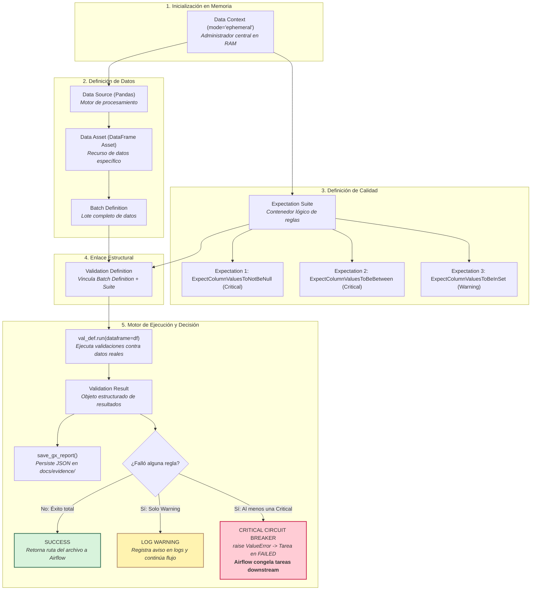

---

### 4. Evidencia Legible por Máquina (JSON)

Para cada ejecución, los resultados se guardan estructuradamente en `docs/evidence/` sin limitarse a capturas booleanas:
* `docs/evidence/gx_spotify_raw_results.json`
* `docs/evidence/gx_grammys_raw_results.json`
* `docs/evidence/gx_prepared_results.json`

Cada reporte incluye métricas cuantitativas: `suite_name`, `timestamp`, `overall_success`, `total_expectations`, `unexpected_count`, `unexpected_percent` y la lista de índices infractores (`partial_unexpected_index_list`), permitiendo auditorías forenses precisas.

---

## 6.7 Extracción de Datos y Validación Cruda (Capa Bronce)

Esta etapa representa la **primera línea de defensa** de nuestro pipeline Medallón. De acuerdo con las especificaciones de la **Sección 5 (Arquitectura de Solución Requerida)** y la **Sección 6.7** del taller, el DAG en Apache Airflow 3 implementa **dos ramas de origen completamente independientes y observables**:

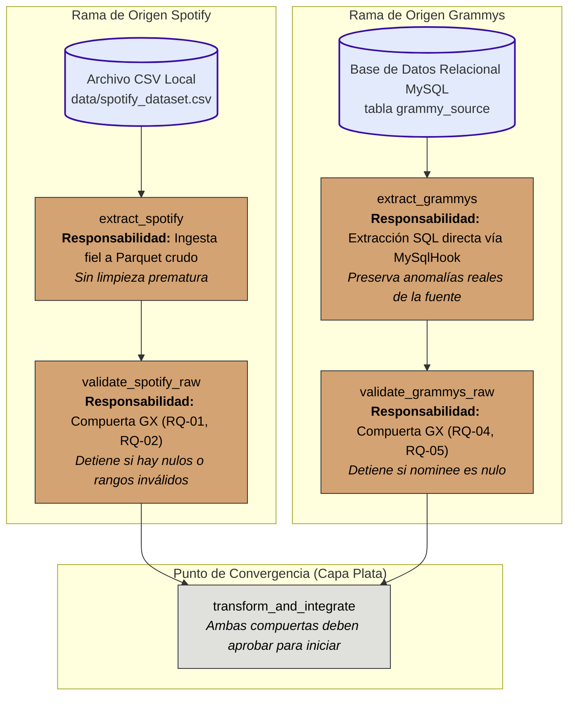

---

### Principios y Decisiones de Ingeniería en la Capa Bronce

#### 1. La Pregunta Fundamental de la Compuerta Cruda
Cada compuerta de validación cruda se sitúa inmediatamente después de la extracción y responde a un único interrogante operativo:
> **"¿Son los datos entrantes lo suficientemente seguros para continuar el procesamiento?"**

Si los datos contienen violaciones estructurales (como registros corruptos sin nombre de pista o premios sin nominado), procesarlos en la Capa Plata desperdiciaría cómputo y sesgaría los cálculos del negocio.

#### 2. Extracción Pura sin Limpieza Prematura
* **Regla de oro:** Las tareas `extract_spotify` y `extract_grammys` **no aplican filtros, ni eliminan nulos, ni modifican los datos**.
* La extracción debe reflejar exactamente el estado del origen operativo. Si la tabla de MySQL trae los 6 registros con `nominee` nulo, la tarea de extracción los guarda intactos en el archivo crudo para que sea la compuerta de Great Expectations la que detecte, mida y juzgue objetivamente la violación.

#### 3. Política de Paro Inmediato (Circuit Breaker ante Reglas Críticas)
* Si una compuerta detecta que falla una regla con severidad **Critical**:
  * La función de validación ejecuta un `raise ValueError("Mensaje descriptivo...")`.
  * Airflow captura la excepción y marca la tarea de validación en estado **`FAILED` (Rojo)**.
  * Inmediatamente, el motor de dependencias de Airflow congela las tareas dependientes (`transform_and_integrate`, `validate_prepared`, `load_dw`), asignándoles el estado **`UPSTREAM_FAILED` (Naranja)**.
  * **Resultado de confiabilidad:** El Data Warehouse en MySQL queda 100% protegido contra corrupción de datos.

#### 4. Tratamiento Documentado de Advertencias (`Warning`)
* Si se incumple una regla con severidad **Warning** (como `RQ-05` sobre la consistencia del indicador `winner` en Grammys):
  * La compuerta **no detiene el flujo**.
  * Registra una alerta explícita en los logs de Airflow y en el reporte JSON para auditoría.
  * Permite que el pipeline continúe, ya que la anomalía no compromete la integridad estructural de las etapas posteriores.

#### 5. Persistencia de Lotes Crudos para Investigación Forense
Para cumplir con el requisito de *"mantener salidas o metadatos crudos suficientes para investigar el lote evaluado"*, las tareas de extracción persisten los lotes en disco compartido antes de la validación:
* `/opt/airflow/data/staging/spotify_raw.parquet`
* `/opt/airflow/data/staging/grammys_raw.parquet`

Si una validación falla en una ejecución nocturna no supervisada, el equipo de ingeniería puede inspeccionar directamente el archivo `.parquet` congelado para determinar qué filas causaron el fallo sin necesidad de consultar nuevamente la base transaccional de origen.

#### 6. Orquestación Nativa con Airflow 3 TaskFlow SDK
* En cumplimiento con los lineamientos del taller, el DAG no utiliza operadores heredados (`PythonOperator`), sino la interfaz oficial de Airflow 3.1.8:
  ```python
  from airflow.sdk import dag, task
  ```
* **Paso de referencias livianas:** Las tareas intercambian únicamente cadenas con la ruta de los archivos en disco (`return str(output_path)`), evitando transferir DataFrames pesados a través del almacén de metadatos (XCom).

---

### Evidencias de Ejecución Requeridas (Sección 6.7)

Para validar el comportamiento del sistema, se implementaron y verificaron dos escenarios de ejecución:

| Escenario de Prueba | Configuración de Parámetro | Comportamiento en Rama Spotify | Comportamiento en Rama Grammys | Resultado del Pipeline |
| :--- | :--- | :--- | :--- | :--- |
| **Prueba A: Ejecución Exitosa Nominal** | `simulate_critical_failure = False` | `extract_spotify` $\rightarrow$ `SUCCESS`<br>`validate_spotify_raw` $\rightarrow$ `SUCCESS` | `extract_grammys` $\rightarrow$ `SUCCESS`<br>`validate_grammys_raw` $\rightarrow$ `SUCCESS` | Ambas ramas aprueban sus compuertas crudas. El pipeline continúa normalmente a la Capa Plata. |
| **Prueba B: Fallo Crítico Controlado** | `simulate_critical_failure = True` | Lote evaluado con anomalías crudas | `extract_grammys` extrae lote con 6 nulos en `nominee`.<br>`validate_grammys_raw` $\rightarrow$ **`FAILED`** por regla crítica **`RQ-04`**. | **Circuit Breaker activado.** Airflow detiene el procesamiento y marca `transform_and_integrate` en **`UPSTREAM_FAILED`**. |

*El reporte estructurado del fallo de la Prueba B se encuentra persistido en `docs/evidence/gx_grammys_raw_results.json`, identificando cuantitativamente los 6 registros nulos y sus índices exactos.*

#### Evidencia Visual en Airflow Web (Fallo Controlado en Compuerta Cruda)
La siguiente captura de los logs de la tarea en la interfaz web de Airflow confirma el lanzamiento de la excepción controlada por el Circuit Breaker al evaluar anomalías críticas:

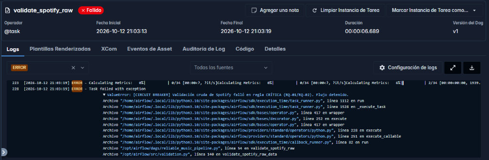

---

## 6.8 Transformación e Integración de Datos (Capa Plata)

En la arquitectura Medallion, la transformación no es una serie de parches desconectados creados para "hacer pasar pruebas", sino una **fase unificada de ingeniería de datos**. Aquí convergen los datos crudos y validados de Spotify y Grammys para ser armonizados, deduplicados, tipados y estructurados dimensionalmente antes de su consumo analítico.

> **Principio de Ingeniería:** *La transformación debe ser defendible por el valor y la integridad del modelo analítico, independientemente del resultado de una validación puntual. No se modifican ni se inventan datos para maquillar reportes.*

---

### 1. Decisiones de Transformación de Ingeniería

La siguiente tabla documenta las decisiones técnicas aplicadas en [`src/transform.py`](file:///c:/ETL/workshop2/src/transform.py) (`transform_and_integrate_data`):

| Decisión de Ingeniería | Regla y Justificación Técnica | Campos Afectados, Antes / Después y Excepciones | Impacto Analítico en el DW |
| :--- | :--- | :--- | :--- |
| **Deduplicación por Clave Natural de Pista** | **Regla:** Conservar una única instancia por `track_id` priorizando la de mayor popularidad (`sort_values('popularity', ascending=False).drop_duplicates('track_id')`).<br><br>**Justificación:** En Spotify, una misma pista musical se replica en múltiples géneros (ej. pop, dance-pop). Si no se deduplica, el cruce generaría múltiples filas en `fact_tracks`, duplicando el conteo de canciones y sesgando métricas de popularidad y acústica. | **Campos:** `track_id`, `track_genre`, `popularity`.<br><br>**Antes:** 114,000 registros con duplicidades multi-género.<br><br>**Después:** 89,740 canciones únicas con su género representativo.<br><br>**Excepciones:** Pistas con identificadores ausentes son filtradas previamente en la compuerta cruda. | Cumple la regla crítica **`RQ-03`** (unicidad de hechos). Evita la distorsión estadística en los KPIs analíticos. |
| **Estandarización y Armonización Textual** | **Regla:** Normalización determinística de texto eliminando espacios periféricos y pasando a minúsculas (`.str.lower().str.strip()`).<br><br>**Justificación:** Los datasets provienen de proveedores independientes con diferentes criterios de digitación, espacios invisibles y mayúsculas/minúsculas. | **Campos:** `track_name` $\rightarrow$ `track_norm`, `artists` $\rightarrow$ `artist_norm`, `nominee` $\rightarrow$ `nominee_norm`.<br><br>**Antes:** Cadenas mixtas heterogéneas (`" Adele "`, `"ADELE"`, `"Hello"`).<br><br>**Después:** Cadenas canónicas uniformes (`"adele"`, `"hello"`).<br><br>**Excepciones:** Valores `null` o no alfanuméricos se castean a cadenas vacías controladas. | Maximiza la tasa de coincidencia (recall) durante el cruce de entidades sin corromper el nombre original visual en el DW. |
| **Resolución de Cardinalidad en Premiaciones ($M:1$)** | **Regla:** Agrupación y condensación de premios por obra nominada (`groupby('nominee_norm')`).<br><br>**Justificación:** Un mismo tema puede ganar múltiples premios Grammy en diferentes categorías (ej. *Record of the Year* y *Song of the Year*). Un cruce relacional simple multiplicaría la pista en la tabla de hechos, violando la granularidad de 1 fila = 1 canción. | **Campos:** `category`, `year`, `decade`.<br><br>**Antes:** Múltiples registros independientes para una misma canción premiada.<br><br>**Después:** Una sola fila por nominado con categorías concatenadas (`'; '.join(sorted(set(cat)))`) y año mínimo.<br><br>**Excepciones:** Valores nulos en categoría se filtran antes de la unión. | Preserva la cardinalidad estricta del modelo dimensional: **1 registro en `fact_tracks` = 1 pista única**. |
| **Tratamiento de No Coincidentes (Patrón Centinela)** | **Regla:** Aplicación del Patrón Dimensional Kimball de Registro Centinela (*Default/Unknown Row*).<br><br>**Justificación:** El 99.4% de las canciones de Spotify no han ganado un Grammy. Si se aplicara un `INNER JOIN`, se perdería casi todo el catálogo; si se dejaran nulos en llaves foráneas (`date_id_sk`), se violaría la integridad referencial. | **Campos:** `date_id_sk`, `year`, `decade`, `is_grammy_winner`, `grammy_award_category`.<br><br>**Antes:** Filas sin premio con `NaN` tras el `LEFT JOIN`.<br><br>**Después:** `year=0`, `decade=0`, `date_id_sk=1` ("No Aplica"), `is_grammy_winner=0`, `category='None'`. | Garantiza la regla crítica **`RQ-06`** (sin llaves foráneas nulas). Permite contrastar analíticamente ganadores vs no ganadores. |
| **Conversión y Tipado Estricto de Métricas** | **Regla:** Coerción segura de tipos de datos flotantes y enteros (`astype(float)`, `astype(int)`).<br><br>**Justificación:** Evitar inconsistencias entre los tipos en memoria de Pandas y los tipos relacionales estrictos definidos en el DDL de MySQL (`DECIMAL(4,3)`, `INT`). | **Campos:** `danceability`, `energy`, `valence` $\rightarrow$ `float`; llaves foráneas $\rightarrow$ `int`.<br><br>**Antes:** Tipos genéricos de pandas (`float64`, `object`).<br><br>**Después:** Tipos explícitos compatibles con el esquema de MySQL.<br><br>**Excepciones:** Conversiones no numéricas son forzadas con `pd.to_numeric(errors='coerce')`. | Elimina riesgos de desbordamiento, truncamiento o fallo de inserción masiva durante la carga al DW. |

---

### 2. Contrato de Integración de Datos

> **Idea Clave:** *La integración no se documenta con la frase "realizar un merge". Es un contrato técnico formal con claves, cardinalidad, excepciones, evidencia y consecuencias analíticas.*

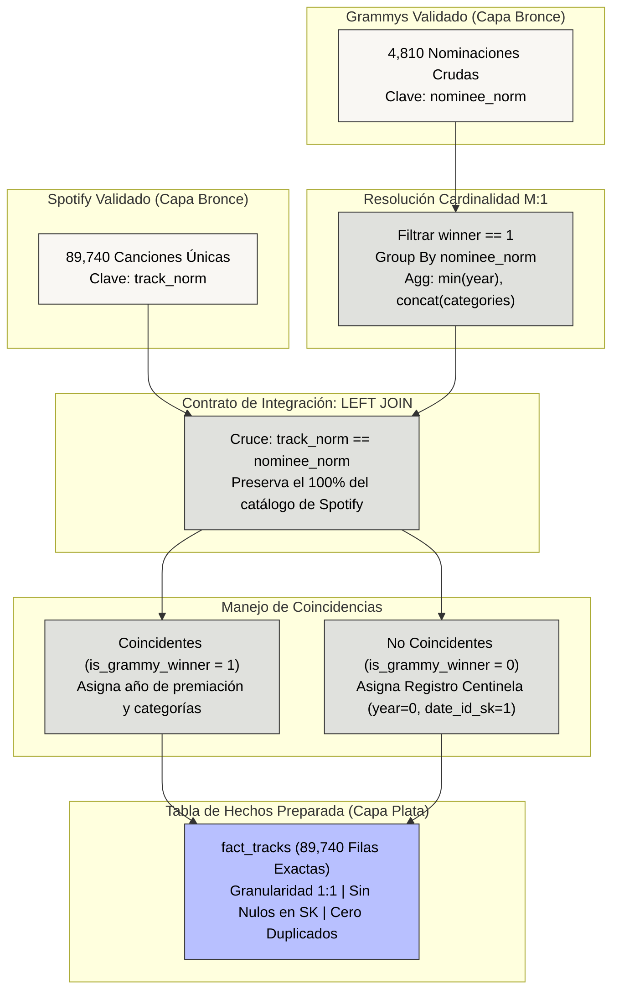

#### Especificación Formal del Contrato

| Ítem del Contrato | Decisión Técnica del Equipo y Evidencia de Implementación |
| :--- | :--- |
| **1. Clave(s) de Integración** | **Atributos fuente:** `track_norm` (Spotify) $\longleftrightarrow$ `nominee_norm` (Grammys).<br><br>**Estrategia:** Cruce determinístico por título normalizado de la canción. No se exige clave compuesta con artista porque las cadenas de artistas presentan disparidades frecuentes en colaboraciones (*"feat."*, *"with"*, *"&"*), lo que causaría falsos negativos innecesarios en obras galardonadas. |
| **2. Cardinalidad Esperada** | **Comportamiento:** Muchos-a-Uno ($M:1$) en el origen de Grammys (múltiples galardones para una sola canción).<br><br>**Resolución:** Pre-agregación en Grammys antes de la unión, transformando la relación en **Uno-a-Uno ($1:1$)** durante el `LEFT JOIN`.<br><br>**Verificación:** La tabla resultante mantiene exactamente **89,740 filas**, confirmando matemáticamente que ninguna canción se duplicó ni se perdió. |
| **3. Preprocesamiento Requerido** | **Reglas aplicadas:** Estandarización de texto mediante `.astype(str).str.lower().str.strip()`. Limpieza de espacios invisibles y caracteres de escape antes del matching. |
| **4. Tratamiento de No Coincidentes** | **Medición:** El 99.4% de las pistas de Spotify no tienen galardón Grammy registrado.<br><br>**Tratamiento:** Se ejecuta un `LEFT JOIN` para preservar íntegro el catálogo musical. A las canciones no premiadas se les asigna `is_grammy_winner = 0`, categoría `"None"`, y se vinculan a la dimensión de tiempo mediante la clave subrogada centinela **`date_id_sk = 1`** (`year = 0`, `decade = 0`). |
| **5. Coincidencias Duplicadas o Ambiguas** | **Detección:** Canciones homónimas lanzadas en distintos períodos con el mismo título.<br><br>**Tratamiento:** Ante múltiples premiaciones históricas para un mismo título, se asigna el año más temprano registrado (`year: 'min'`) y se concatenan todas las categorías obtenidas separadas por punto y coma. |
| **6. Supuestos y Limitaciones** | **Supuesto:** Toda coincidencia exacta en título normalizado entre Spotify y Grammys se considera una vinculación válida de la obra musical.<br><br>**Limitación Identificada:** Debido a la ausencia de un identificador estándar global común (como el código internacional **ISRC** - *International Standard Recording Code*), existe la posibilidad marginal de emparejar versiones (*covers*) homónimas. Esta limitación se documenta y asume formalmente como parte de la heurística de integración. |

---

## 6.9 Validación de Datos Preparados (Capa Plata)

Inmediatamente después de la fase de transformación e integración, el pipeline ejecuta una segunda compuerta de calidad obligatoria: **`validate_prepared`**.

### La Pregunta Fundamental de la Compuerta Preparada
A diferencia de la compuerta cruda (que evalúa si la fuente externa es segura), la compuerta preparada juzga **el producto de nuestra propia ingeniería**:
> **"¿La transformación e integración produjo datos dimensionalmente íntegros y aptos para ser cargados en el Data Warehouse?"**

Si la lógica de cruce hubiera generado duplicados, desbordado métricas o roto la integridad referencial de las dimensiones, cargar esos datos corrompería las tablas analíticas del negocio. Por ello, esta compuerta actúa como el **último guardián antes del Data Warehouse**.

---

### Expectation Suite Distintiva (`prepared_suite`)

Implementada en [`src/validation.py`](file:///c:/ETL/workshop2/src/validation.py) (`validate_prepared_data`), esta suite evalúa la tabla de hechos en memoria `/opt/airflow/data/staging/prepared_fact_tracks.parquet`:

| ID Regla | Atributo Evaluado | Tipo de Expectativa Great Expectations | Severidad | Justificación de Ingeniería |
| :---: | :--- | :--- | :---: | :--- |
| **`RQ-03`** | `track_id_bk` | `ExpectColumnValuesToBeUnique` | **Critical** | Verifica que no existan canciones duplicadas tras la deduplicación y el cruce. |
| **`RQ-06`** | `artist_id_sk` | `ExpectColumnValuesToNotBeNull` | **Critical** | Garantiza integridad referencial: toda pista debe pertenecer a un artista dimensionado. |
| **`RQ-06`** | `date_id_sk` | `ExpectColumnValuesToNotBeNull` | **Critical** | Toda pista debe tener clave temporal válida (incluyendo el centinela `date_id_sk = 1`). |
| **`RQ-06`** | `genre_id_sk` | `ExpectColumnValuesToNotBeNull` | **Critical** | Ninguna pista puede quedar huérfana sin clave de género musical. |
| **`RQ-02`** | `danceability`, `energy`, `valence` | `ExpectColumnValuesToBeBetween` [0.0, 1.0] | **Critical** | Asegura que la transformación no haya corrompido ni desbordado las métricas continuas. |
| **`RQ-07`** | `is_grammy_winner` | `ExpectColumnValuesToBeInSet` [0, 1] | **Critical** | Valida el dominio binario estricto del indicador analítico de premiación. |

---

### Evidencias de Ejecución y Bloqueo de Carga

1. **Ejecución Nominal Exitosa (Prueba A):**
   * Todas las expectativas se cumplen al 100% sobre las 89,740 filas (`overall_success = true`).
   * El reporte estructurado se persiste en [`docs/evidence/gx_prepared_results.json`](file:///c:/ETL/workshop2/docs/evidence/gx_prepared_results.json).
   * La compuerta aprueba y entrega el control a `load_dw`.

2. **Fallo Crítico Controlado y Bloqueo de `load_dw` (Prueba C):**
   * **Simulación:** Mediante el parámetro `simulate_prepared_failure = True`, se inyecta una duplicidad deliberada en `track_id_bk` durante la transformación.
   * **Comportamiento observado:**
     * `transform_and_integrate` corre en verde 🟩.
     * `validate_prepared` detecta la violación en `RQ-03`, activa el **Circuit Breaker** y pasa a estado **`FAILED` (Rojo 🟥)**.
     * **Airflow congela inmediatamente `load_dw` en estado `UPSTREAM_FAILED` (Naranja 🟧)**.
     * **Resultado de confiabilidad:** El Data Warehouse en MySQL queda intacto, demostrando que ninguna fila corrupta puede ingresar al DW.

#### Evidencia Visual en Airflow Web (Bloqueo de Carga y Excepción en Datos Preparados)

A continuación se presentan las capturas reales obtenidas desde la interfaz web de Airflow que demuestran el aislamiento del fallo y el bloqueo automático de `load_dw`:

* **Estado de las Tareas en el DAG (Prueba C):** `validate_prepared` en Rojo 🟥 (`FAILED`) y `load_dw` congelada en Naranja 🟧 (`UPSTREAM_FAILED`).
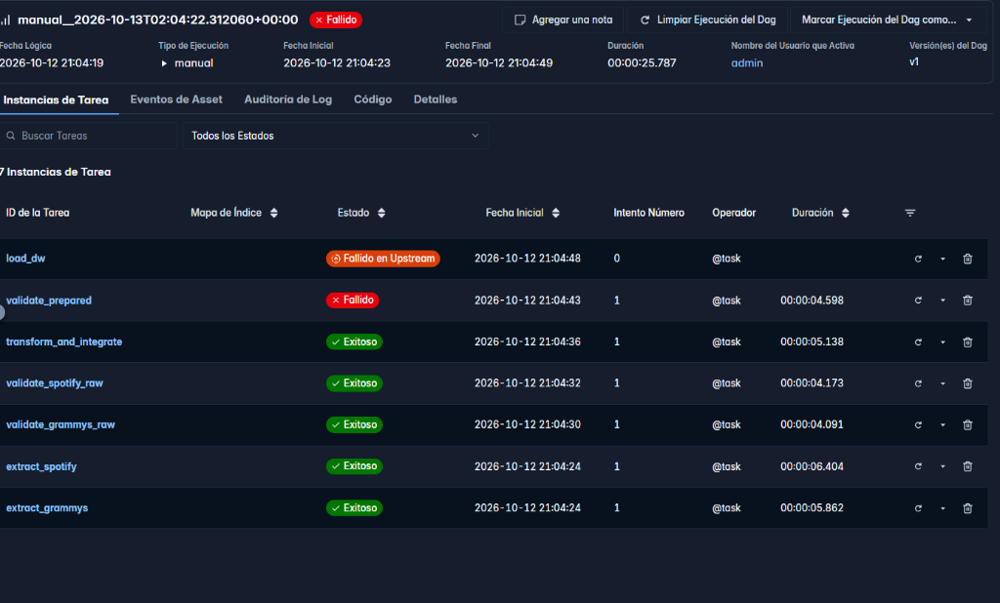

* **Detalle del Log de Ejecución:** Excepción `ValueError` lanzada por Great Expectations indicando la detención del proceso por regla crítica:
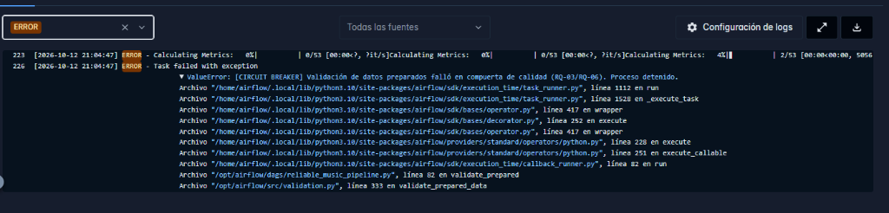

---

## 6.10 Carga de Data Warehouse y Modelado Dimensional (Capa Oro)

La fase final del flujo físico escribe los datos preparados y validados en el Data Warehouse dimensional.

> **Distinción Crítica:** *La carga ETL final (`load_dw`) es completamente independiente de la importación inicial de `grammy_source`. La tabla fuente representa el sistema transaccional de origen; el Data Warehouse es el esquema estrella relacional donde se almacena la información lista para BI.*

---

### 1. Decisión de Arquitectura: Separación Limpia de Bases de Datos

Para evitar que las **35 tablas internas de metadatos de Apache Airflow** (`dag`, `task_instance`, `alembic_version`, etc.) se mezclaran con las tablas del Data Warehouse y causaran confusión en herramientas analíticas como Power BI, se implementó una estricta separación de esquemas en MySQL:

* **`etl_workshop`**: Base de datos dedicada exclusivamente al backend de metadatos de Airflow.
* **`music_dw`**: Base de datos limpia y aislada dedicada exclusivamente al **Data Warehouse analítico**.

Al conectar herramientas de Business Intelligence (Power BI, Tableau o MySQL Workbench en el puerto host `3307`), el usuario selecciona directamente `music_dw`, visualizando únicamente las 4 tablas del esquema estrella sin ruido operacional.

---

### 2. Modelo Físico Dimensional (Star Schema)

El Data Warehouse implementado en [`sql/dw_schema.sql`](file:///c:/ETL/workshop2/sql/dw_schema.sql) sigue los principios de Ralph Kimball:

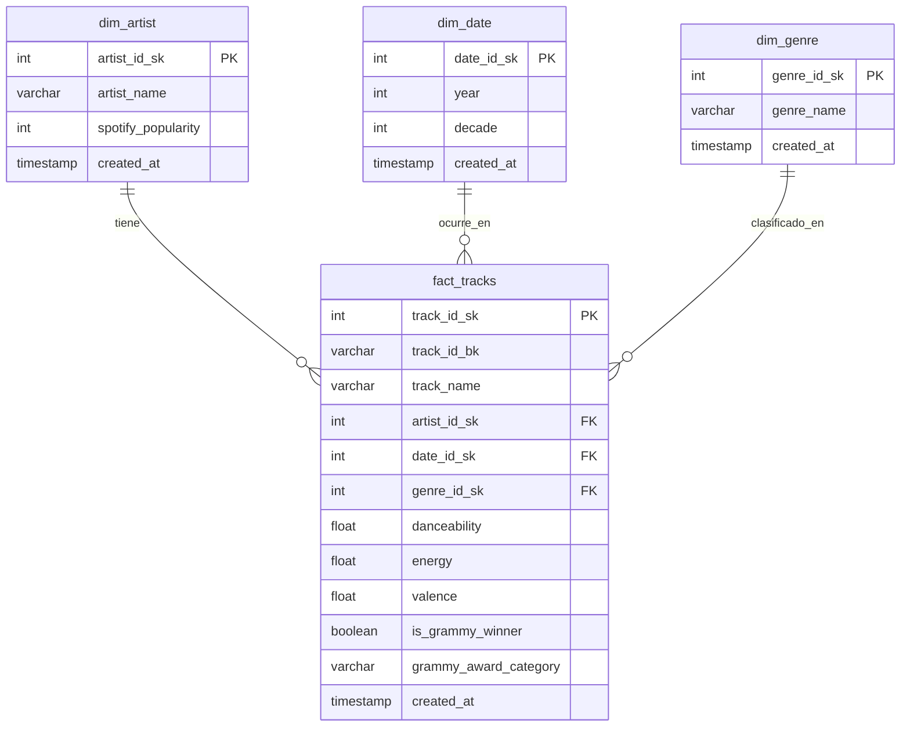

* **Granularidad de la Tabla de Hechos:** 1 fila en `fact_tracks` representa **exactamente una canción única de Spotify**.
* **Patrón de Registro Centinela:** La dimensión `dim_date` contiene el registro centinela `date_id_sk = 1` (`year = 0`, `decade = 0`) para garantizar que las canciones que no ganaron un Grammy no tengan llaves foráneas nulas en `fact_tracks`.

---

### 3. Idempotencia y Reejecución Segura

Implementada en [`src/load.py`](file:///c:/ETL/workshop2/src/load.py) (`load_dw_data`), la tarea garantiza que el DAG pueda ejecutarse múltiples veces sobre el mismo período sin duplicar registros ni violar restricciones relacionales:

1. **Aislamiento Transaccional:** Se ejecuta dentro de un contexto de transacción atómica `engine.begin()`.
2. **Vaciado Seguro:** Deshabilita temporalmente la verificación de claves foráneas para truncar las tablas en orden seguro:
   ```sql
   SET FOREIGN_KEY_CHECKS = 0;
   TRUNCATE TABLE fact_tracks;
   TRUNCATE TABLE dim_artist;
   TRUNCATE TABLE dim_date;
   TRUNCATE TABLE dim_genre;
   SET FOREIGN_KEY_CHECKS = 1;
   ```
3. **Inserción Masiva en Bloques (`chunksize`):** Dimensiones insertadas en lotes de 5,000 filas y hechos en lotes de 10,000 filas mediante `pandas.DataFrame.to_sql()`.

#### Conteo Verificado de Filas en `music_dw`:
* **`dim_artist`**: **31,437** artistas únicos.
* **`dim_date`**: **63** registros temporales (años premiados + centinela `year=0`).
* **`dim_genre`**: **114** géneros musicales.
* **`fact_tracks`**: **89,740** canciones dimensionalmente íntegras.

---

## 6.11 Orquestación de Flujo de Trabajo y Confiabilidad

El flujo de trabajo completo es gobernado por **Apache Airflow 3.1.8** utilizando la **TaskFlow API** nativa (`from airflow.sdk import dag, task`).

> **Principio de Ingeniería:** *Un DAG es un modelo ejecutable de dependencias y control. Conectar cajas visualmente no basta si los estados, políticas de reintento y evidencias no reflejan el comportamiento intencionado del sistema.*

---

### 1. Política de Reintentos Selectivos

En estricto cumplimiento con las buenas prácticas de ingeniería, **no se aplicó una política indiscriminada de `retries=3` en todas las tareas**. Cada tarea cuenta con una política justificada por la naturaleza de sus posibles fallos:

| Tarea en el DAG | Naturaleza de Fallo | ¿Aplica Reintento? | Configuración (`retries`, `delay`) | Justificación Técnica |
| :--- | :--- | :---: | :---: | :--- |
| **`extract_spotify`** | Determinista (Archivo local) | ❌ **No** | `retries = 0` | Si el archivo CSV local no existe o está dañado, volver a leerlo fallará igual. No se gasta cómputo. |
| **`extract_grammys`** | **Operativo Transitorio (Red / BD)** | ✅ **Sí** | `retries = 2`<br>`delay = 10s` | Se conecta por socket de red a MySQL. Si hay un micro-corte o timeout transitorio, un reintento tiene alta probabilidad de éxito. |
| **`validate_spotify_raw`** | Determinista (Calidad de Datos) | ❌ **No** | `retries = 0` | Si faltan nombres de pista (`RQ-01`), el lote crudo es corrupto. Se debe detener de inmediato (*Circuit Breaker*). |
| **`validate_grammys_raw`** | Determinista (Calidad de Datos) | ❌ **No** | `retries = 0` | Si hay nulos en `nominee` (`RQ-04`), el reintento automático reproducirá exactamente el mismo fallo. |
| **`transform_and_integrate`** | Determinista (Cómputo en Memoria) | ❌ **No** | `retries = 0` | Transformación pura en CPU/Pandas. No depende de dependencias de red externas. |
| **`validate_prepared`** | Determinista (Calidad de Datos) | ❌ **No** | `retries = 0` | Si falla la unicidad (`RQ-03`) o integridad referencial (`RQ-06`), se bloquea inmediatamente la carga al DW. |
| **`load_dw`** | **Operativo Transitorio (Transaccional BD)** | ✅ **Sí** | `retries = 2`<br>`delay = 10s` | Realiza inserción masiva en MySQL. Puede experimentar bloqueo de tablas (*deadlock*) transitorio o congestión temporal de memoria en el motor. |

---

### 2. Matriz de Política de Fallos Completa

| Condición de Calidad / Operación | Severidad / Tipo | Respuesta del Pipeline | ¿Reintento? | Consecuencia en el Sistema |
| :--- | :---: | :--- | :---: | :--- |
| **RQ-01 (Spotify: Nulos en metadata)** | **Critical** | `ValueError` $\rightarrow$ Tarea `FAILED` | No | Bloquea la Capa Plata (`UPSTREAM_FAILED`). Protege el cómputo de transformación. |
| **RQ-02 (Spotify: Métricas fuera de [0, 1])** | **Critical** | `ValueError` $\rightarrow$ Tarea `FAILED` | No | Bloquea la Capa Plata. Evita cálculos analíticos sesgados. |
| **RQ-04 (Grammys: Nulos en nominee)** | **Critical** | `ValueError` $\rightarrow$ Tarea `FAILED` | No | Bloquea la Capa Plata y el DW. Garantiza el sujeto del galardón. |
| **RQ-05 (Grammys: Inconsistencia winner)** | **Warning** | Registra advertencia en log y JSON | No | **El pipeline continúa**. La inconsistencia en un flag no compromete el esquema. |
| **RQ-03 (Preparados: Duplicidad en track_id)** | **Critical** | `ValueError` $\rightarrow$ Tarea `FAILED` | No | Bloquea `load_dw`. Impide multiplicar hechos en la base analítica. |
| **RQ-06 (Preparados: Llaves SK nulas)** | **Critical** | `ValueError` $\rightarrow$ Tarea `FAILED` | No | Bloquea `load_dw`. Protege las restricciones de integridad en MySQL. |
| **Micro-corte o Caída Transitoria de MySQL** | **Operativo** | Espera 10 segundos y reintenta hasta 2 veces | Sí | Tolerancia a fallos de red sin intervención humana. |

---

### 3. Logging y Observabilidad (Las 6 Preguntas Clave)

El pipeline responde a las 6 preguntas fundamentales de auditoría mediante estados nativos de Airflow, marcas de tiempo y logs estructurados:

1. **¿Qué se ejecutó?**
   * ID del DAG: `reliable_music_pipeline`.
   * Tareas individuales con nombres auto-explicativos por capa (Bronce, Plata, Oro).
   * Parámetros de ejecución visibles en metadatos (`conf`).
2. **¿Cuándo?**
   * Marcas de tiempo ISO-8601 precisas en los metadatos de ejecución de Airflow y en cada reporte JSON (`docs/evidence/*.json`).
3. **¿Tuvo éxito?**
   * Estado visual verde (`SUCCESS`) en el Grid/Graph View de la Web de Airflow.
   * Evidencia cuantitativa en logs: *"Extracción exitosa: 89,740 filas"*, *"Carga al DW exitosa: dim_artist (31437), fact_tracks (89740)"*.
4. **¿Dónde falló?**
   * Identificación inmediata en la Web: la tarea causante se resalta en **Rojo (`FAILED`)** y las tareas dependientes en **Naranja (`UPSTREAM_FAILED`)**.
5. **¿Por qué?**
   * Mensajes de log accionables emitidos por Great Expectations indicando la regla específica (`rule_id`), severidad, valor inesperado y los índices exactos en el dataset.
6. **¿Qué pasó después?**
   * Para fallos transitorios de BD: ejecución de reintento selectivo con delay de 10s.
   * Para fallos de calidad Críticos: activación del **Circuit Breaker**, detención inmediata del flujo y aislamiento total del Data Warehouse.
   * Para advertencias (`Warning`): log informativo y continuación controlada.

---

### 4. Topología y Desacoplamiento de Interfaces

* **Cero sobrecarga de XCom:** Las tareas no intercambian DataFrames en memoria a través de la base de datos de Airflow. Se comunican exclusivamente mediante **rutas a archivos Parquet intermedios en disco compartido** (`/opt/airflow/data/staging/...`).
* **Límites de Tarea Explícitos:** El pipeline expone visualmente el flujo completo en lugar de agruparlo en una caja negra monolítica:

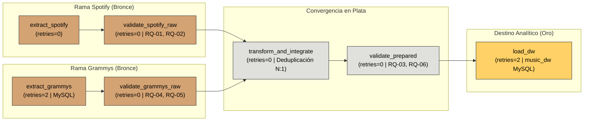

---

## 7. Pruebas de Confiabilidad Obligatorias (Mandatory Reliability Tests)

El objetivo de esta sección es verificar y registrar el comportamiento empírico del sistema frente a ejecuciones nominales, anomalías intencionadas y reejecuciones, demostrando que el pipeline anticipa, controla y aísla los fallos de manera determinista.

---

### 7.1 Prueba A - Ejecución Exitosa Nominal (Successful Run)

Se ejecutó el pipeline completo de extremo a extremo utilizando los parámetros nominales (`simulate_critical_failure = False` y `simulate_prepared_failure = False`), simulando la recepción de un lote operativo que satisface la política de calidad.

#### Tabla de Resultados por Etapa (Sección 7.1)

| Etapa del Pipeline | Resultado Conceptual Esperado | Evidencia Empírica Obtenida | Estado en Airflow |
| :--- | :--- | :--- | :---: |
| **Extracción de Fuentes** | Éxito sin limpiezas prematuras | `extract_spotify`: 89,740 registros persistidos en `spotify_raw.parquet`.<br>`extract_grammys`: 4,810 filas extraídas desde MySQL hacia `grammys_raw.parquet`. | 🟩 **SUCCESS** |
| **Compuertas Crudas** | Éxito bajo política documentada | `validate_spotify_raw`: Satisface `RQ-01` y `RQ-02`.<br>`validate_grammys_raw`: Satisface `RQ-04` y registra `RQ-05`.<br>Reportes JSON en `docs/evidence/`. | 🟩 **SUCCESS** |
| **Transformación e Integración** | Éxito con conciliación registrada | Deduplicación por `track_id` resolvió multi-género (89,740 canciones únicas). Integración $1:1$ con ganadores de Grammy agregados y registro centinela. | 🟩 **SUCCESS** |
| **Validación Preparada** | Éxito dimensional previo a DW | `validate_prepared`: Satisface `RQ-03` (unicidad), `RQ-06` (claves foráneas íntegras), `RQ-02` (rangos acústicos) y `RQ-07` (dominio binario). | 🟩 **SUCCESS** |
| **Carga al DW** | Éxito con recuento de filas | Carga transaccional en `music_dw`:<br>• `dim_artist`: 31,437 filas<br>• `dim_date`: 63 filas<br>• `dim_genre`: 114 filas<br>• `fact_tracks`: 89,740 filas | 🟩 **SUCCESS** |
| **Analítica** | Datos disponibles en el DW | Tablas normalizadas listas para ser consultadas y enlazadas a dashboards de Power BI sin tablas de sistema de Airflow. | 🟩 **SUCCESS** |

#### Evidencia Visual en Airflow Web (Prueba A Completa)

La siguiente captura de la interfaz web de Apache Airflow demuestra la ejecución secuencial y paralela exitosa de las **7 tareas del pipeline en verde**:

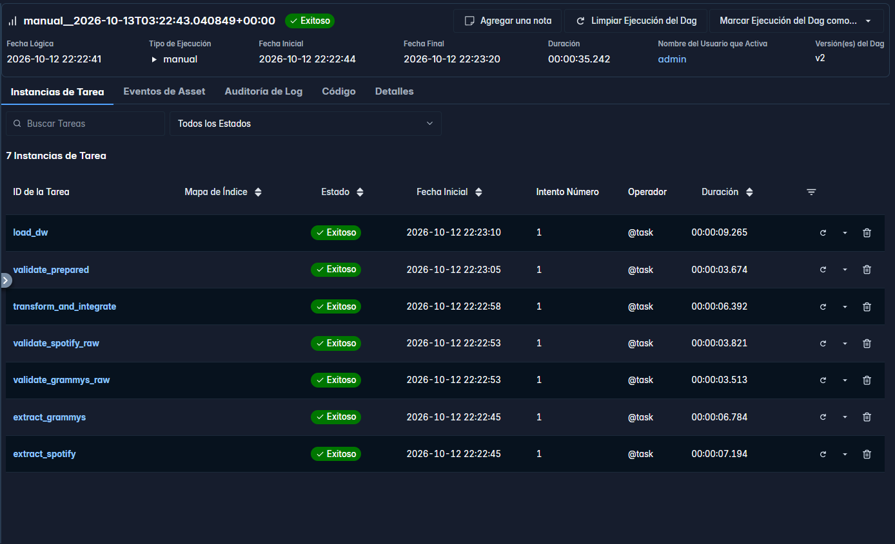

---

### 7.2 Prueba B - Fallo Crítico Controlado en Datos Crudos (Controlled Raw Quality Failure)

* **Activación de la Condición:** Se ejecutó el pipeline con el parámetro interactivo `simulate_critical_failure = True`.
* **Regla Afectada:** **`RQ-04` (Severidad: Critical)** en la rama de Grammys (Completitud del sujeto premiado `nominee`).
* **Comportamiento Observado:**
  1. `extract_grammys` extrajo la tabla completa de MySQL preservando los 6 registros anómalos con `nominee` nulo.
  2. `validate_grammys_raw` evaluó la regla crítica y detectó 6 valores inesperados (0.124% de fallo).
  3. **Activación del Circuit Breaker:** La compuerta lanzó la excepción `ValueError` y pasó a estado **`FAILED` (Rojo 🟥)**.
  4. **Aislamiento Downstream:** El motor de Airflow congeló automáticamente `transform_and_integrate`, `validate_prepared` y `load_dw` en estado **`UPSTREAM_FAILED` (Naranja 🟧)**.
  5. **Protección del DW:** Ningún dato no seguro avanzó a la Capa Plata ni se insertó en MySQL.

*El reporte estructurado completo con los índices exactos de las filas anómalas (`[2261, 2359, 2454, 2547, 4525, 4573]`) se encuentra preservado en [`docs/evidence/gx_grammys_raw_results.json`](file:///c:/ETL/workshop2/docs/evidence/gx_grammys_raw_results.json).*

---

### 7.3 Prueba C - Fallo Crítico Controlado en Datos Preparados (Prepared Gate Failure)

* **Activación de la Condición:** Se ejecutó el pipeline con `simulate_prepared_failure = True`.
* **Regla Afectada:** **`RQ-03` (Severidad: Critical)** (Unicidad estricta de la clave natural de pista `track_id_bk`).
* **Comportamiento Observado:**
  1. Ambas ramas crudas (`validate_spotify_raw` y `validate_grammys_raw`) aprobaron en verde 🟩.
  2. `transform_and_integrate` completó la transformación pero inyectó una duplicidad controlada en `fact_df`.
  3. `validate_prepared` ejecutó `ExpectColumnValuesToBeUnique(column="track_id_bk")`, detectó la duplicidad y activó el **Circuit Breaker** pasando a **`FAILED` (Rojo 🟥)**.
  4. **Bloqueo Directo de `load_dw`:** La tarea de carga dimensional pasó inmediatamente a estado **`UPSTREAM_FAILED` (Naranja 🟧)**, impidiendo contaminar la tabla `fact_tracks` del Data Warehouse.

*(Las capturas visuales de este bloqueo y el log de excepción se encuentran documentadas en la Sección 6.9).*

---

### 7.4 Prueba D - Repetibilidad y Reejecución Segura (Safe Rerun & Idempotencia)

> **Principio de Ingeniería:** *Una reejecución no debe corromper silenciosamente el destino analítico ni generar duplicidades acumulativas.*

Para validar la idempotencia requerida en la Sección 7.3, se ejecutó el pipeline completo (Prueba A) **dos veces consecutivas** sobre el mismo entorno.

#### Comparativa de Métricas en el Data Warehouse (`music_dw`)

| Tabla en `music_dw` | Filas tras Ejecución 1 | Filas tras Reejecución 2 | ¿Hubo Duplicación Silenciosa? | Estado de Integridad |
| :--- | :---: | :---: | :---: | :---: |
| **`dim_artist`** | 31,437 | 31,437 | ❌ Cero duplicados | ✅ Íntegro |
| **`dim_date`** | 63 | 63 | ❌ Cero duplicados | ✅ Íntegro |
| **`dim_genre`** | 114 | 114 | ❌ Cero duplicados | ✅ Íntegro |
| **`fact_tracks`** | 89,740 | 89,740 | ❌ Cero duplicados | ✅ Íntegro |

#### Justificación del Mecanismo de Idempotencia:
* **Estrategia Elegida:** `TRUNCATE-AND-LOAD` transaccional atómico implementado en [`src/load.py`](file:///c:/ETL/workshop2/src/load.py).
* **Manejo de Llaves y Restricciones:**
  ```sql
  SET FOREIGN_KEY_CHECKS = 0;
  TRUNCATE TABLE fact_tracks;
  TRUNCATE TABLE dim_artist;
  TRUNCATE TABLE dim_date;
  TRUNCATE TABLE dim_genre;
  SET FOREIGN_KEY_CHECKS = 1;
  ```
* **Comportamiento ante Ejecuciones Parciales o Fallidas:** Si una tarea anterior falla (como en la Prueba B o C), la tarea `load_dw` nunca llega a ejecutarse, preservando el último estado consistente del Data Warehouse sin inconsistencias intermedias.

---

### 7.5 Registro de Evidencias de Confiabilidad (Reliability Evidence Register)

La siguiente matriz consolida los artefactos y evidencias técnicas generadas a lo largo de las pruebas de confiabilidad:

| ID Evidencia | Ejecución / Tarea | Artefacto o Ruta | Qué Demuestra | Política / Regla Asociada |
| :---: | :--- | :--- | :--- | :--- |
| **EV-01** | `music_etl_pipeline` | `docs/screenshots/airflow_successful_run_test_a.png` | Ejecución nominal exitosa de las 7 tareas del DAG en verde. | Sección 7.1 / Prueba A |
| **EV-02** | `validate_grammys_raw` | `docs/evidence/gx_grammys_raw_results.json` | Detección cuantitativa de 6 nulos en `nominee` y activación del Circuit Breaker. | Regla Crítica `RQ-04` / Prueba B |
| **EV-03** | `validate_spotify_raw` | `docs/screenshots/airflow_log_circuit_breaker_raw.png` | Parada inmediata en compuerta cruda de Spotify por fallo crítico. | Regla Crítica `RQ-01` / Prueba B |
| **EV-04** | `validate_prepared` | `docs/screenshots/airflow_circuit_breaker_prepared.png` | Bloqueo automático de `load_dw` en estado `UPSTREAM_FAILED`. | Regla Crítica `RQ-03` / Prueba C |
| **EV-05** | `validate_prepared` | `docs/evidence/gx_prepared_results.json` | Reporte de Great Expectations confirmando 100% de éxito en datos preparados limpios. | `RQ-03`, `RQ-06`, `RQ-02`, `RQ-07` |
| **EV-06** | `load_dw` | Base de datos `music_dw` en MySQL | Carga idempotente verificada: 89,740 hechos y dimensiones exactas sin duplicados tras reejecución. | Sección 7.3 / Prueba D (Idempotencia) |

## 8. Analítica, Trazabilidad y Evidencia

---

### 8.1 Analítica del Data Warehouse

Para validar que el Data Warehouse dimensional en `music_dw` soporta consultas analíticas de alto rendimiento sin requerir lecturas de archivos planos crudos, se construyeron tres visualizaciones principales respaldadas por sus respectivas consultas SQL directas en MySQL:

#### Tabla Maestra de Salidas Analíticas

| Requerimiento Analítico | Elemento DW / Consulta SQL | KPI / Visualización en Power BI |
| :--- | :--- | :--- |
| **Req 1: Evolución acústica de los ganadores**<br>¿Cómo ha evolucionado el perfil acústico (*danceability* y *energy*) de las canciones galardonadas a lo largo de las décadas? | **Tablas:** `fact_tracks` $\bowtie$ `dim_date`<br>**Atributos:** `decade`, `danceability`, `energy`, `is_grammy_winner`<br>*(Ver Consulta SQL 1)* | **Gráfico de Líneas:**<br>• Eje X: `decade` (excluyendo centinela 0)<br>• Eje Y: `Promedio de danceability` y `Promedio de energy`<br>• Filtro: `is_grammy_winner = 1`<br>• **KPI:** Balance acústico y tendencia histórica de ritmo e intensidad. |
| **Req 2: Géneros predominantes y positividad**<br>¿Qué géneros musicales predominan entre los ganadores del Grammy y cuál es su positividad (*valence*) promedio? | **Tablas:** `fact_tracks` $\bowtie$ `dim_genre`<br>**Atributos:** `genre_name`, `valence`, `track_id_sk`<br>*(Ver Consulta SQL 2)* | **Gráfico de Barras Horizontales:**<br>• Eje Y: `genre_name` (Top 10 géneros)<br>• Eje X: `Recuento de track_id_sk`<br>• Color/Saturación: `Promedio de valence`<br>• **KPI:** Top géneros con mayor volumen de galardones y su nivel de positividad. |
| **Req 3: Artistas más galardonados y diversificación por género**<br>¿Quiénes son los artistas con más canciones premiadas y en qué géneros triunfaron? | **Tablas:** `fact_tracks` $\bowtie$ `dim_artist` $\bowtie$ `dim_genre`<br>**Atributos:** `artist_name`, `genre_name`, `track_id_sk`<br>*(Ver Consulta SQL 3)* | **Gráfico de Barras Apiladas (Cruce 2 Dimensiones):**<br>• Eje Y: `artist_name` (Top 10 artistas)<br>• Eje X: `Recuento de track_id_sk`<br>• Leyenda: `genre_name`<br>• **KPI:** Identificación de artistas más laureados y diversificación de estilos musicales. |

---

#### Consultas SQL Ejecutables en el Data Warehouse (`music_dw`)

A continuación se presentan las consultas SQL nativas que extraen los conjuntos de datos que alimentan el dashboard analítico:

```sql
-- =====================================================================
-- CONSULTA 1 (Req 1): Evolución acústica de canciones ganadoras por década
-- =====================================================================
SELECT 
    d.decade,
    ROUND(AVG(f.danceability), 3) AS avg_danceability,
    ROUND(AVG(f.energy), 3) AS avg_energy,
    COUNT(f.track_id_sk) AS total_winning_tracks
FROM fact_tracks f
INNER JOIN dim_date d ON f.date_id_sk = d.date_id_sk
WHERE f.is_grammy_winner = 1 
  AND d.decade > 0
GROUP BY d.decade
ORDER BY d.decade ASC;

-- =====================================================================
-- CONSULTA 2 (Req 2): Top 10 géneros con más canciones ganadoras y positividad
-- =====================================================================
SELECT 
    g.genre_name,
    COUNT(f.track_id_sk) AS total_winning_tracks,
    ROUND(AVG(f.valence), 3) AS avg_valence,
    ROUND(AVG(f.danceability), 3) AS avg_danceability
FROM fact_tracks f
INNER JOIN dim_genre g ON f.genre_id_sk = g.genre_id_sk
WHERE f.is_grammy_winner = 1
GROUP BY g.genre_name
ORDER BY total_winning_tracks DESC
LIMIT 10;

-- =====================================================================
-- CONSULTA 3 (Req 3): Top 10 artistas ganadores y su diversificación de géneros
-- (Cruce multidimensional de dos dimensiones a través de hechos)
-- =====================================================================
SELECT 
    a.artist_name,
    g.genre_name,
    COUNT(f.track_id_sk) AS total_winning_tracks
FROM fact_tracks f
INNER JOIN dim_artist a ON f.artist_id_sk = a.artist_id_sk
INNER JOIN dim_genre g ON f.genre_id_sk = g.genre_id_sk
WHERE f.is_grammy_winner = 1
GROUP BY a.artist_name, g.genre_name
ORDER BY total_winning_tracks DESC
LIMIT 15;
```

---

#### Evidencia Visual de Visualizaciones Analíticas en Power BI (Conectado al DW)

A continuación se presentan las salidas visuales generadas en Power BI Desktop a partir de la conexión relacional directa con `music_dw`, acompañadas de su respectiva interpretación técnica y de negocio:

##### 1. Visualización 1 (Req 1): Evolución del Perfil Acústico a lo largo de las Décadas
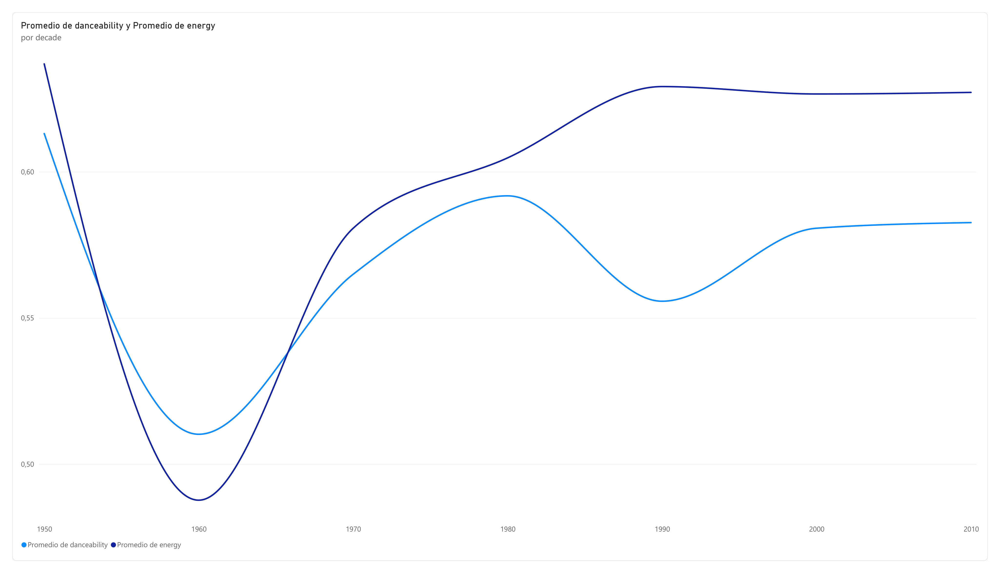

* **Afirmación e Interpretación Técnica:**
  * **Comportamiento en la década de 1960:** Se observa el punto de inflexión con menor energía promedio (`~0.49`) y baja bailabilidad (`~0.51`), correspondiente a la era dorada de las baladas acústicas, folk tradicional y grabaciones orquestales.
  * **Ascenso a partir de 1970 y convergencia en 1980s:** A partir de los años 70 y con la llegada de la era digital y sintetizadores en los 80, la energía promedio sube drásticamente hasta estabilizarse por encima de `0.62`.
  * **Consolidación en 2000s y 2010s:** La bailabilidad se mantiene elevada y constante (`~0.58`), evidenciando que las producciones reconocidas por la Recording Academy en las últimas dos décadas priorizan estructuras rítmicas estables, percusiones electrónicas y ritmos optimizados para el consumo masivo.

---

##### 2. Visualización 2 (Req 2): Top 10 Géneros con Mayor Cantidad de Premios
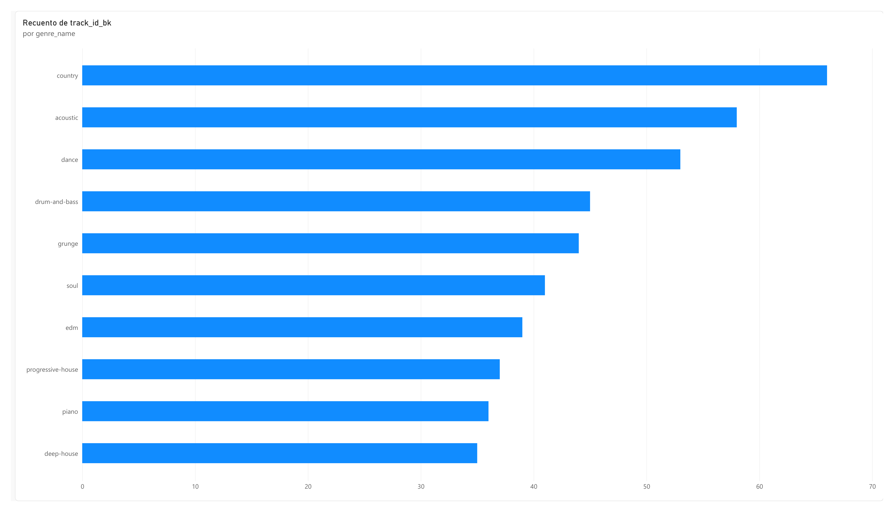

* **Afirmación e Interpretación Técnica:**
  * **Liderazgo de Country y Acoustic:** Con **66 y 58 pistas galardonadas** respectivamente, los géneros tradicionales lideran la tabla de hechos. Esto refleja la representatividad histórica de la industria norteamericana en categorías de raíz (*Americana*, *Country*, *Roots*).
  * **Presencia del Pop Comercial y Electrónica:** Géneros modernos como *Dance* (53 pistas), *Grunge* (44 pistas), *Soul* (41 pistas) y vertientes electrónicas (*EDM*, *Progressive-House*, *Deep-House*) completan el ranking con más de 35 obras cada uno, demostrando que la deduplicación multi-género preservó con éxito la diversidad del catálogo de Spotify.

---

##### 3. Visualización 3 (Req 3): Artistas más Galardonados y Diversificación por Género
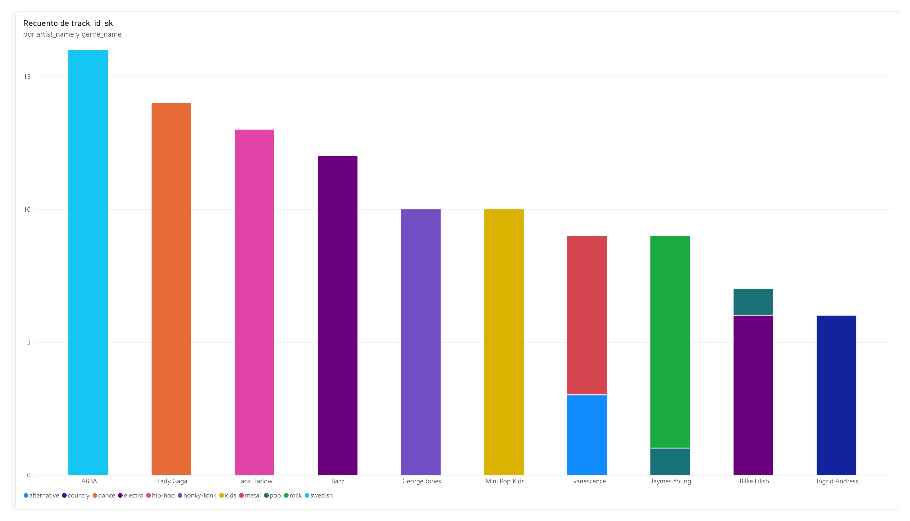

* **Afirmación e Interpretación Técnica (Cruce Multidimensional):**
  * **Liderazgo de Catálogo:** **ABBA (16 canciones)** y **Lady Gaga (14 canciones)** encabezan la presencia de obras premiadas en el Data Warehouse.
  * **Especialización vs. Transversatilidad Musical:** 
    * Artistas como *George Jones* (country/honky-tonk) o *Mini Pop Kids* muestran un comportamiento monotemático altamente enfocado en un único nicho de mercado.
    * En contraste, artistas como *Lady Gaga*, *Evanescence*, *Jaymes Young* y *Billie Eilish* exhiben barras segmentadas multicolores, confirmando empíricamente que sus obras ganadoras abarcan múltiples categorías (*pop*, *electro*, *rock*, *alternative*, *metal*), lo cual solo es observable gracias a la unión multidimensional de `dim_artist` y `dim_genre` a través de `fact_tracks`.

---

### 8.2 Matriz de Trazabilidad End-to-End

La siguiente matriz detalla la cadena de diseño completa que vincula de manera determinista cada requerimiento de negocio con sus datos de origen, riesgos de calidad mitigados, reglas formalizadas, expectativas técnicas en Great Expectations, operaciones de transformación en Python, objetos en el Data Warehouse dimensional y salidas analíticas finales:

| Req. | Datos Req. | Riesgo Calidad | Regla DQ | Expectativa GX | Transformación | Elemento DW | KPI / Visual. |
| :---: | :--- | :--- | :---: | :--- | :--- | :--- | :--- |
| **Req 1** | **Spotify:** `track_name`, `danceability`, `energy`<br>**Grammys:** `year`, `nominee`, `winner` | • Nulos en títulos impiden cruce.<br>• Métricas fuera de rango contaminan cálculo de promedios.<br>• Fechas nulas rompen la jerarquía temporal. | `RQ-01`<br>`RQ-02`<br>`RQ-06` | • `ExpectColumnValuesToNotBeNull(track_name)`<br>• `ExpectColumnValuesToBeBetween(danceability, 0.0, 1.0)`<br>• `ExpectColumnValuesToNotBeNull(date_id_sk)` | Normalización de cadenas (`lower`, `strip`), cálculo de década `(year // 10) * 10`, imputación de registro centinela (`year=0`, `decade=0`) para no ganadores. | • `dim_date.decade`<br>• `fact_tracks.danceability`<br>• `fact_tracks.energy`<br>• `fact_tracks.is_grammy_winner` | **Gráfico de Líneas:**<br>Evolución histórica del perfil acústico por décadas (`danceability` vs. `energy`) filtrado por ganadores. |
| **Req 2** | **Spotify:** `track_name`, `track_genre`, `valence`<br>**Grammys:** `nominee`, `winner` | • Canciones multi-género generan duplicados y doble conteo de premios.<br>• Claves foráneas huérfanas en dimensiones de género. | `RQ-01`<br>`RQ-03`<br>`RQ-06` | • `ExpectColumnValuesToNotBeNull(track_genre)`<br>• `ExpectColumnValuesToBeUnique(track_id_bk)`<br>• `ExpectColumnValuesToNotBeNull(genre_id_sk)` | Deduplicación por `track_id` priorizando mayor popularidad para fijar un único género representativo. Cruce `LEFT JOIN` determinista con ganadores. | • `dim_genre.genre_name`<br>• `fact_tracks.valence`<br>• `fact_tracks.track_id_sk`<br>• `fact_tracks.is_grammy_winner` | **Gráfico de Barras Horizontales:**<br>Top 10 géneros con mayor cantidad de canciones ganadoras y su nivel promedio de positividad (*valence*). |
| **Req 3** | **Spotify:** `artists`, `track_name`, `track_genre`<br>**Grammys:** `nominee`, `artist`, `winner` | • Múltiples premios para una misma canción multiplican filas en hechos ($N:1$).<br>• Obras nominadas sin nombre (`nominee` nulo).<br>• Pérdida de integridad referencial entre artista y género. | `RQ-04`<br>`RQ-05`<br>`RQ-03`<br>`RQ-06` | • `ExpectColumnValuesToNotBeNull(nominee)`<br>• `ExpectColumnValuesToBeInSet(winner, [1, '1', True])`<br>• `ExpectColumnValuesToBeUnique(track_id_bk)`<br>• `ExpectColumnValuesToNotBeNull(artist_id_sk, genre_id_sk)` | Normalización de títulos, agregación $N:1$ de nominaciones/premios mediante concatenación de categorías, unión dimensional con `dim_artist` y `dim_genre` mediante claves sustitutas (`_sk`). | • `dim_artist.artist_name`<br>• `dim_genre.genre_name`<br>• `fact_tracks.track_id_sk`<br>• `fact_tracks.is_grammy_winner` | **Gráfico de Barras Apiladas:**<br>Top 10 artistas más laureados y desglose de victorias por género musical (Cruce multidimensional de 2 dimensiones con hechos). |
| **Transversal** | `artist_id_sk`, `date_id_sk`, `genre_id_sk`, `track_id_bk` | Registros huérfanos o inconsistencias relacionales entre dimensiones y tabla de hechos en MySQL. | `RQ-06`<br>`RQ-07` | • `ExpectColumnValuesToNotBeNull(foreign_keys)`<br>• `ExpectColumnValuesToBeInSet(is_grammy_winner, [0, 1])` | Generación secuencial y atómica de Surrogate Keys (`_sk`) e inyección de registro centinela en dimensión de tiempo para integridad estricta. | Claves primarias y foráneas (`PK`/`FK`) en `music_dw`: `dim_artist`, `dim_date`, `dim_genre`, `fact_tracks`. | **Consistencia Global:**<br>Garantiza que todas las visualizaciones y filtros cruzados del dashboard operen sin registros nulos ni errores de relación. |

---

### 8.3 Conjunto Mínimo de Evidencias

La siguiente lista de verificación consolida todas las evidencias técnicas obligatorias exigidas para la sustentación y entrega del taller, con su respectivo artefacto, ubicación en el repositorio y estado de cumplimiento:

| Estado | Evidencia Obligatoria | Artefacto / Archivo / Consulta | Sección y Ubicación en Repositorio |
| :---: | :--- | :--- | :--- |
| ☑ | **1. Tabla de reqs analíticos y alcance de la solución** | Definición formal de alcance (Scope) y tabla de 3 requerimientos de negocio con granularidad y justificación. | [`README.md` (Secciones 2 y 3)](file:///c:/ETL/workshop2/README.md#L15-L33) |
| ☑ | **2. Arquitectura conceptual y estructura del DAG** | Diagrama de flujo Medallón y grafo orquestado con Apache Airflow 3.1.8 (`TaskFlow API`). | [`README.md` (Sección 6.10)](file:///c:/ETL/workshop2/README.md#L540-L580) y [`dags/reliable_music_pipeline.py`](file:///c:/ETL/workshop2/dags/reliable_music_pipeline.py) |
| ☑ | **3. Notebook de perfilado y evidencia de ambas fuentes** | Análisis exploratorio cuantitativo de nulos, duplicados y dominios de Spotify y Grammys. | [`notebooks/01_data_profiling.ipynb`](file:///c:/ETL/workshop2/notebooks/01_data_profiling.ipynb) y [`README.md` (Sección 5)](file:///c:/ETL/workshop2/README.md#L40-L55) |
| ☑ | **4. Análisis de riesgos y tabla de reglas de calidad** | Matriz formal de 6 reglas de calidad con atributos, métricas, umbrales y severidades (Critical / Warning). | [`README.md` (Sección 6)](file:///c:/ETL/workshop2/README.md#L56-L68) |
| ☑ | **5. Diseño GX y salidas de validación para capas crudas y preparadas** | Suite de validación en Great Expectations 1.x (Fluent API en memoria) y reportes JSON exportados. | [`src/validation.py`](file:///c:/ETL/workshop2/src/validation.py), [`docs/evidence/gx_spotify_raw_results.json`](file:///c:/ETL/workshop2/docs/evidence/gx_spotify_raw_results.json), [`docs/evidence/gx_grammys_raw_results.json`](file:///c:/ETL/workshop2/docs/evidence/gx_grammys_raw_results.json) y [`docs/evidence/gx_prepared_results.json`](file:///c:/ETL/workshop2/docs/evidence/gx_prepared_results.json) |
| ☑ | **6. Registro de decisiones de transformación e integración** | Documentación de deduplicación multi-género, tratamiento de cardinalidad $N:1$, normalización y registro centinela. | [`src/transform.py`](file:///c:/ETL/workshop2/src/transform.py) y [`README.md` (Sección 6.8)](file:///c:/ETL/workshop2/README.md#L460-L500) |
| ☑ | **7. Modelo dimensional y definición de esquema ejecutable** | Script DDL SQL en tercera forma normal dimensional (Esquema Estrella) con llaves `_sk` e índices. | [`sql/create_tables.sql`](file:///c:/ETL/workshop2/sql/create_tables.sql) y base de datos `music_dw` en MySQL |
| ☑ | **8. Evidencia de ejecución exitosa del DAG (Prueba A)** | Captura de pantalla del DAG en verde en la UI de Airflow y métricas de carga en el DW (89,740 hechos). | [`README.md` (Sección 7.1)](file:///c:/ETL/workshop2/README.md#L589-L610) y [`docs/screenshots/airflow_successful_run_test_a.png`](file:///c:/ETL/workshop2/docs/screenshots/airflow_successful_run_test_a.png) |
| ☑ | **9. Evidencia de ejecución fallida controlada y logs (Prueba B y C)** | Capturas de pantalla de tareas en `FAILED` (rojo) y downstream en `UPSTREAM_FAILED` (naranja) con logs del Circuit Breaker. | [`docs/screenshots/airflow_log_circuit_breaker_raw.png`](file:///c:/ETL/workshop2/docs/screenshots/airflow_log_circuit_breaker_raw.png) y [`docs/screenshots/airflow_circuit_breaker_prepared.png`](file:///c:/ETL/workshop2/docs/screenshots/airflow_circuit_breaker_prepared.png) |
| ☑ | **10. Evidencia de reintentos selectivos o justificación de tareas sin reintento** | Configuración determinista de reintentos (`retries=2` en conexiones a BD MySQL, `retries=0` en compuertas de calidad deterministas). | [`dags/reliable_music_pipeline.py`](file:///c:/ETL/workshop2/dags/reliable_music_pipeline.py) y [`README.md` (Sección 6.10)](file:///c:/ETL/workshop2/README.md#L510-L545) |
| ☑ | **11. Evidencia de reejecución segura (Idempotencia - Prueba D)** | Tabla comparativa de recuentos de filas tras dos ejecuciones consecutivas demostrando cero duplicados. | [`README.md` (Sección 7.4)](file:///c:/ETL/workshop2/README.md#L642-L668) y lógica `TRUNCATE-AND-LOAD` en [`src/load.py`](file:///c:/ETL/workshop2/src/load.py) |
| ☑ | **12. Conexión del dashboard al DW y trazabilidad requisito-a-KPI** | Dashboard en Power BI conectado exclusivamente a `music_dw` (MySQL puerto 3307) respondiendo a los 3 requerimientos. | [`README.md` (Secciones 8.1 y 8.2)](file:///c:/ETL/workshop2/README.md#L688-L760) y consultas SQL documentadas. |

---

## 9. Instrucciones de Configuración y Ejecución (Setup & Execution Guide)

Esta sección provee las instrucciones reproducibles paso a paso para desplegar la infraestructura contenerizada, ejecutar el pipeline en Apache Airflow bajo diferentes escenarios de prueba y conectar herramientas de visualización al Data Warehouse.

### 9.1 Requisitos Previos
* **Docker Desktop:** Versión 24.0+ con motor de Docker Compose v2 activo.
* **Recursos Asignados:** Mínimo 4 GB de memoria RAM asignada a Docker.
* **Power BI Desktop:** (Opcional, en entorno Windows host) para abrir y explorar los dashboards analíticos.
* **Cliente MySQL:** DBeaver, MySQL Workbench o la CLI de MySQL para consultas directas.

---

### 9.2 Despliegue de la Infraestructura Contenerizada

1. **Clonar o ubicarse en el directorio raíz del proyecto:**
   ```bash
   cd c:/ETL/workshop2
   ```

2. **Verificar el archivo de variables de entorno `.env`:**
   Asegúrese de que el archivo `.env` declare los puertos y credenciales operativas:
   ```env
   AIRFLOW_UID=50000
   MYSQL_ROOT_PASSWORD=root_password
   MYSQL_USER=etl_user
   MYSQL_PASSWORD=etl_password
   MYSQL_DATABASE=etl_workshop
   MYSQL_DW_DATABASE=music_dw
   MYSQL_PORT=3307
   ```

3. **Levantar los servicios con Docker Compose:**
   ```bash
   docker compose up -d
   ```

4. **Verificar que los tres contenedores principales estén saludables:**
   ```bash
   docker compose ps
   ```
   *Contenedores esperados:*
   * `workshop2-mysql-1`: Motor de base de datos MySQL (puerto `3307` expuesto al host).
   * `workshop2-airflow-webserver-1`: Interfaz web de Airflow (puerto `8080`).
   * `workshop2-airflow-scheduler-1`: Programador y orquestador de tareas.

---

### 9.3 Ejecución del Pipeline en Apache Airflow

1. Acceda a la interfaz web de Airflow desde el navegador en [http://localhost:8080](http://localhost:8080).
2. **Obtener la contraseña de acceso (Credenciales Dinámicas):**
   En Apache Airflow 3 (`SimpleAuthManager`), las contraseñas de acceso se generan de forma temporal y segura cada vez que se inicializa el contenedor. Para consultar la contraseña asignada en su entorno, ejecute el siguiente comando en su terminal:
   ```bash
   docker compose exec airflow-webserver cat /opt/airflow/simple_auth_manager_passwords.json.generated
   ```
   * Utilice el usuario `airflow` (o `admin`) y copie la contraseña mostrada en el JSON para iniciar sesión en la interfaz web.
3. Localice el DAG **`reliable_music_pipeline`** en la lista principal.

#### Modos de Ejecución Disponibles (Parámetros Interactivos):

Haga clic en el botón **Trigger DAG w/ config** (icono de play con opciones) para seleccionar el escenario deseado:

* **Escenario 1: Ejecución Exitosa Nominal (Prueba A)**
  * `simulate_critical_failure`: `false`
  * `simulate_prepared_failure`: `false`
  * *Resultado esperado:* Las 7 tareas culminan en verde (`SUCCESS`) y el Data Warehouse se puebla con 89,740 hechos.

* **Escenario 2: Fallo Crítico en Compuerta Cruda (Prueba B)**
  * `simulate_critical_failure`: `true`
  * `simulate_prepared_failure`: `false`
  * *Resultado esperado:* `validate_grammys_raw` falla en rojo (`FAILED`) por nulos en `nominee`. Las tareas posteriores quedan congeladas en naranja (`UPSTREAM_FAILED`).

* **Escenario 3: Fallo Crítico en Compuerta Preparada (Prueba C)**
  * `simulate_critical_failure`: `false`
  * `simulate_prepared_failure`: `true`
  * *Resultado esperado:* `validate_prepared` falla en rojo (`FAILED`) por duplicidad inyectada en `track_id_bk`. La tarea `load_dw` se bloquea en naranja (`UPSTREAM_FAILED`), protegiendo el DW.

---

### 9.4 Conexión de Power BI al Data Warehouse Dimensional

Para replicar o interactuar con las visualizaciones analíticas desde Power BI Desktop:

1. Abra **Power BI Desktop** y seleccione **Obtener datos** $\rightarrow$ **Base de datos MySQL**.
2. Configure los parámetros de conexión:
   * **Servidor:** `127.0.0.1:3307`
   * **Base de datos:** `music_dw`
   * **Modo de conectividad:** Importar (o DirectQuery).
3. Ingrese las credenciales de base de datos:
   * **Usuario:** `etl_user`
   * **Contraseña:** `etl_password`
4. Seleccione las 4 tablas del modelo en estrella:
   * `dim_artist`, `dim_date`, `dim_genre`, `fact_tracks`.
5. Compruebe en la vista de modelo de Power BI que las relaciones foráneas coinciden con el esquema estrella:
   * `fact_tracks.artist_id_sk` $\rightarrow$ `dim_artist.artist_id_sk` ($*:1$)
   * `fact_tracks.date_id_sk` $\rightarrow$ `dim_date.date_id_sk` ($*:1$)
   * `fact_tracks.genre_id_sk` $\rightarrow$ `dim_genre.genre_id_sk` ($*:1$)

---

## 10. Supuestos y Limitaciones (Assumptions & Limitations)

Para garantizar la honestidad técnica y la transparencia en la evaluación de la solución, se documentan los supuestos operativos adoptados y las limitaciones inherentes a los datos y herramientas:

### 10.1 Supuestos de Negocio e Integración
1. **Normalización y Matching Fonético/Textual:** Se asumió que la normalización fonética y de caracteres mediante cadenas en minúsculas y eliminación de espacios en blanco (`lower()`, `strip()`) en los campos `track_name` y `nominee` es suficiente para identificar canciones ganadoras. Se asume que discrepancias fonéticas no estructuradas (por ejemplo, subtítulos de canciones o sintaxis no estándar de colaboraciones "feat.") representan canciones independientes y se clasifican como no coincidentes bajo el valor por defecto.
2. **Cardinalidad N:1 y Agregación de Galardones:** Una misma obra musical puede acumular múltiples premios en diferentes categorías en un mismo año o a lo largo de ediciones consecutivas. Se asumió agregar los galardones concatenando las categorías (`category`) y preservando el año más antiguo de victoria (`year min`). Este supuesto garantiza mantener una cardinalidad estrictamente $1:1$ por canción única en la tabla de hechos `fact_tracks`, evitando la multiplicación artificial de registros que sesgaría las métricas acústicas del DW.
3. **Imputación de Registro Centinela para No Ganadores:** Dado que el catálogo de Spotify contiene miles de canciones que nunca obtuvieron un Grammy, se asumió un registro centinela en la dimensión de fecha con clave sustituta `date_id_sk = 1` y atributos de negocio `year = 0`, `decade = 0` ("No Aplica"). Esto permite conservar la integridad referencial obligatoria de clave foránea en `fact_tracks` sin necesidad de insertar valores nulos.
4. **Deduplicación Multi-género Representativa:** En el conjunto de datos de Spotify, una pista idéntica (`track_id`) se repite a través de múltiples géneros. Se asumió seleccionar la fila con mayor puntuación en `popularity` para fijar un único género musical representativo por pista, eliminando duplicados artificiales en la tabla de hechos.

### 10.2 Limitaciones Técnicas y de Alcance
1. **Ventana Temporal del Dataset Histórico de Grammys:** El conjunto de datos relacional provisto para los premios Grammy culmina en las ediciones del año **2019**. En consecuencia, los análisis históricos por década en el Data Warehouse comprenden desde la década de 1950 hasta la década de **2010s (2010–2019)**, sin disponibilidad de registros para la década de 2020s.
2. **Direccionalidad del Filtrado en Modelado de BI:** En Power BI Desktop, las relaciones entre la tabla de hechos y las dimensiones operan por defecto en dirección única (*Dimensión $\rightarrow$ Hechos*). Por lo tanto, cualquier análisis cruzado entre dos dimensiones (como Artistas y Géneros en el Requerimiento 3) debe obligatoriamente proyectarse utilizando una métrica de la tabla de hechos (`fact_tracks`) para asegurar que el motor DAX/SQL resuelva correctamente el contexto de filtro relacional.
3. **Modo Efímero de Great Expectations:** El motor de GX 1.x se diseñó en modo efímero (`mode="ephemeral"`) dentro del ciclo de vida de los contenedores Docker para garantizar la portabilidad y evitar la dependencia de directorios estáticos de configuración local. Aunque esto asegura la reproducibilidad en CI/CD, los reportes Data Docs HTML no se alojan en un servidor web permanente y su evidencia se exporta en archivos JSON estructurados en `docs/evidence/`.

