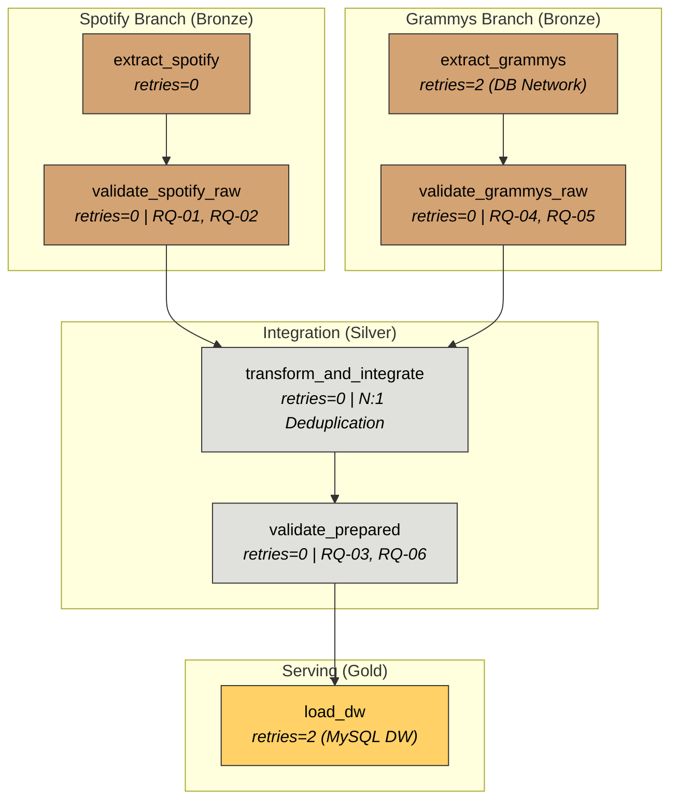

# Workshop 2: Building a Reliable Batch Data Pipeline
**Orchestrated with Apache Airflow 3, Validated with Great Expectations 1.x, and Modeled in MySQL Data Warehouse**
---
**Sebastian Rojas Herrera**
---

## 1. Business Problem & Analytical Objective

The music industry generates massive amounts of data across different platforms:
1. **Spotify Audio Features & Metadata:** Granular technical audio metrics per track (`danceability`, `energy`, `valence`, `popularity`, `track_genre`).
2. **Historical Grammy Awards Data:** Relational records of awards, nominations, and recognized artists.

### Core Problem:
Raw data from operational sources is messy, duplicated, and often incomplete. Connecting analytical dashboards directly to raw CSV files or dirty transactional tables leads to inaccurate business decisions, duplicated metrics, and broken reports.

### Objective:
Design, implement, and orchestrate an end-to-end, production-grade batch ETL pipeline. The pipeline applies automated quality gates using **Great Expectations (GX 1.x)**, handles complex multi-genre deduplication and $N:1$ cardinality integration, and loads clean data into a dedicated **Star Schema Data Warehouse in MySQL (`music_dw`)** to power executive analytics in Power BI.

---

## 2. Solution Scope & Medallion Architecture

The pipeline follows a clean **Medallion Architecture (Bronze $\rightarrow$ Silver $\rightarrow$ Gold)** orchestrated by **Apache Airflow 3.1.8**:

```
+-----------------------------------------------------------------------------------+
|                               MEDALLION ARCHITECTURE                              |
+-----------------------------------------------------------------------------------+
|  BRONZE LAYER (Raw Ingestion)                                                     |
|  - Ingest Spotify CSV (114,000 raw rows) -> spotify_raw.parquet                   |
|  - Ingest Grammys from MySQL (4,810 raw rows) -> grammys_raw.parquet             |
|  - Quality Gates (GX): Complete audit of raw nulls and domains                    |
+-----------------------------------------------------------------------------------+
                                         |
                                         v
+-----------------------------------------------------------------------------------+
|  SILVER LAYER (Transformation & Integration)                                      |
|  - Multi-genre Deduplication: Select highest popularity per track (89,740 unique)|
|  - String Normalization & Clean Left Join with Grammy Winners                     |
|  - Cardinality N:1 Resolution: Group multiple award categories per track          |
|  - Sentinel Record Injection: decade=0 / year=0 for non-winning tracks            |
|  - Prepared Quality Gate (GX): Strict check for unique IDs & non-null Foreign Keys|
+-----------------------------------------------------------------------------------+
                                         |
                                         v
+-----------------------------------------------------------------------------------+
|  GOLD LAYER (Dimensional Serving - Data Warehouse)                                |
|  - Target Database: music_dw (Clean isolation from Airflow metadata)              |
|  - Idempotent Truncate-and-Load with Foreign Key Checks                           |
|  - Star Schema: dim_artist, dim_date, dim_genre, and fact_tracks                  |
|  - Direct Power BI Connection & Executive KPI Dashboards                          |
+-----------------------------------------------------------------------------------+
```

---

## 3. Analytical Requirements

The data pipeline was designed specifically to answer three core business questions:

| Requirement ID | Analytical Question | Source Data Required | DW Tables & Metrics | Business KPI & Visualization |
| :--- | :--- | :--- | :--- | :--- |
| **Req 1: Acoustic Evolution of Grammy Winners** | How have the acoustic profiles (*danceability* and *energy*) of Grammy-winning songs evolved across decades? | **Spotify:** `danceability`, `energy`<br>**Grammys:** `year`, `winner` | `dim_date` $\bowtie$ `fact_tracks`<br>(where `is_grammy_winner = 1`) | **Line Chart:**<br>Average `danceability` and `energy` grouped by `decade` (1950 to 2010). |
| **Req 2: Top Awarded Genres & Positivity** | Which music genres dominate Grammy awards, and what is their average positivity (*valence*)? | **Spotify:** `track_genre`, `valence`<br>**Grammys:** `nominee`, `winner` | `dim_genre` $\bowtie$ `fact_tracks`<br>(where `is_grammy_winner = 1`) | **Horizontal Bar Chart:**<br>Count of winning tracks and average `valence` per `genre_name`. |
| **Req 3: Top Awarded Artists & Genre Diversification** | Who are the most awarded artists in history, and in which genres do their victories concentrate? | **Spotify:** `artists`, `track_genre`<br>**Grammys:** `nominee`, `artist`, `winner` | `dim_artist` $\bowtie$ `dim_genre` $\bowtie$ `fact_tracks` | **Stacked Column Chart (2 Dimensions):**<br>Top 10 artists by winning tracks, segmented by genre colors. |

---

## 4. Data Sources

1. **Spotify Tracks Dataset (`spotify_dataset.csv`):**
   * **Size:** 114,000 rows, 21 columns.
   * **Nature:** Semi-structured flat file containing acoustic metrics calculated by Spotify's Web API (`danceability`, `energy`, `valence`, `tempo`, `popularity`, `track_genre`).
2. **Grammy Awards Operational Table (`grammy_source` in MySQL):**
   * **Size:** 4,810 rows, 10 columns.
   * **Nature:** Relational operational table storing historical award records from 1958 to 2019 (`year`, `category`, `nominee`, `artist`, `winner`).

---

## 5. Data Profiling Findings

Before designing quality rules, we profiled both datasets in [`notebooks/01_data_profiling.ipynb`](notebooks/01_data_profiling.ipynb):

### Spotify Dataset Findings:
* **Completeness:** Found 1 corrupt record with `NaN` in `artists`, `album_name`, and `track_name` (0.0008%).
* **Uniqueness:** Found **24,259 duplicate rows** when evaluating `track_id`. 
  * *Root Cause Analysis:* Spotify tracks frequently belong to multiple genres (e.g., a track appears under `pop`, `dance`, and `electronic`).
  * *Design Decision:* Deduplicate by `track_id` keeping the record with the highest `popularity` to preserve one representative genre per song and prevent duplicate counting in the fact table.
* **Range Validity:** Audio features (`danceability`, `energy`, `valence`) strictly respect the `[0.0, 1.0]` API domain.

### Grammys Dataset Findings:
* **Critical Nulls:** Identified **6 records where `nominee` is null**. Since `nominee` is the awarded song or album, these rows represent corrupted awards that cannot be joined.
* **Acceptable Business Nulls:** 38% nulls in the `artist` column. This is normal because awards for album packaging, production, or technical engineering are awarded to the record itself, not to a single artist.
* **Winner Flag Consistency:** 100% of rows have `winner = 1`, confirming this table represents only actual wins.

---

## 6. Data Quality Risks & Formal Rules (DQ Matrix)

Based on the profiling findings, we established a formal Data Quality Contract:

| Rule ID | Layer / Dataset | Target Column(s) | Quality Dimension | Expectation Description | Threshold | Severity | Business Impact if Violated |
| :---: | :--- | :--- | :--- | :--- | :---: | :---: | :--- |
| **RQ-01** | Spotify (Raw) | `track_name`, `artists` | Completeness | Track and artist names must not be null. | 0 nulls | **Critical** | Prevents broken joins with Grammy nominees. |
| **RQ-02** | Spotify (Raw) | `danceability`, `energy`, `valence` | Validity | Acoustic metrics must fall within `[0.0, 1.0]`. | `[0.0, 1.0]` | **Critical** | Prevents distorted average calculations in KPIs. |
| **RQ-03** | Prepared (Silver) | `track_id_bk` | Uniqueness | Primary natural key must be 100% unique after deduplication. | 0 duplicates | **Critical** | Prevents metric duplication in `fact_tracks`. |
| **RQ-04** | Grammys (Raw) | `nominee` | Completeness | The award subject (`nominee`) must not be null. | 0 nulls | **Critical** | Controlled circuit breaker test in Test B. |
| **RQ-05** | Grammys (Raw) | `winner` | Consistency | Winner column values must represent positive wins (`1`, `'1'`, `True`). | Set: `[1, '1', True]` | **Warning** | Logs warning but does not stop the pipeline. |
| **RQ-06** | Prepared (Silver) | `artist_id_sk`, `date_id_sk`, `genre_id_sk` | Integrity | Foreign keys in the fact table must not contain nulls. | 0 nulls | **Critical** | Prevents orphan records in the Star Schema. |

---

## 7. Great Expectations (GX 1.x) Design & Implementation

We implemented **Great Expectations 1.24+** in **in-memory Ephemeral Mode (`mode="ephemeral"`)** inside [`src/validation.py`](src/validation.py).

### Why Ephemeral Mode?
* **Zero Local Config Drift:** Avoids hardcoded `.yml` files in local folders that break when running inside distributed Docker containers.
* **CI/CD Ready:** Suits stateless cloud pipelines perfectly.
* **Machine-Readable Evidence:** Validation outputs are automatically exported as JSON files to [`docs/evidence/`](docs/evidence/).

### The 5 Structural Building Blocks of GX:
1. **Data Context (`context`):** Initializes the in-memory validation engine.
2. **Data Source & Data Asset:** Registers Pandas DataFrames and whole batch definitions (`add_batch_definition_whole_dataframe`).
3. **Expectation Suite (`suite`):** Logical bundle containing atomic validation rules.
4. **Validation Definition (`val_def`):** Binds the Batch Definition with the Expectation Suite.
5. **Execution & Checkpoint (`val_def.run()`):** Evaluates live data, saves JSON results, and triggers the **Circuit Breaker** (`raise ValueError`) if any critical rule fails.

---

## 8. Transformation & Integration Strategy (Silver Layer)

All transformations in [`src/transform.py`](src/transform.py) were built around 4 key architectural decisions:

1. **Multi-Genre Deduplication:**
   ```python
   # Sort by popularity descending and keep first track_id
   df_sp_clean = df_sp_raw.sort_values(by='popularity', ascending=False).drop_duplicates(subset=['track_id'])
   ```
2. **Cardinality N:1 Resolution:**
   A song can win multiple Grammy categories across different years. Merging without grouping would duplicate facts. We aggregate winners by song title:
   ```python
   winning_tracks = grammy_winners.groupby('nominee_norm').agg({
       'year': 'min',
       'decade': 'min',
       'category': lambda s: '; '.join(sorted(set(s.dropna().astype(str))))
   }).reset_index()
   ```
3. **Sentinel Record for Non-Winners:**
   Non-winning songs (95%+ of Spotify) do not have a Grammy year. Instead of leaving null foreign keys, we assign a sentinel date record (`year=0`, `decade=0` = "Not Applicable") with surrogate key `date_id_sk=1`.
4. **String Normalization:**
   Track names and nominee strings are standardized using lowercase, whitespace stripping, and special character sanitization to maximize join quality.

---

## 9. Dimensional Modeling (Star Schema in MySQL `music_dw`)

We strictly separated our data warehouse (`music_dw`) from Airflow's internal metadata database (`etl_workshop`).

### Star Schema Architecture:
```
                      +-------------------+
                      |     dim_date      |
                      +-------------------+
                      | PK date_id_sk     |
                      |    year           |
                      |    decade         |
                      +-------------------+
                                |
                                | 1:N
                                v
+------------------+  +-------------------+  +------------------+
|    dim_artist    |  |    fact_tracks    |  |    dim_genre     |
+------------------+  +-------------------+  +------------------+
| PK artist_id_sk  |  | PK track_id_sk    |  | PK genre_id_sk   |
|    artist_name   |<-| FK artist_id_sk   |->|    genre_name    |
|spotify_popularity|  | FK date_id_sk     |  +------------------+
+------------------+  | FK genre_id_sk    |
                      |    danceability   |
                      |    energy         |
                      |    valence        |
                      |  is_grammy_winner |
                      |    category       |
                      +-------------------+
```

### Verified Row Counts in `music_dw`:
* **`dim_artist`:** 31,437 unique artists.
* **`dim_date`:** 63 unique year/decade combinations (including sentinel record 0).
* **`dim_genre`:** 114 unique musical genres.
* **`fact_tracks`:** 89,740 unique tracks.

---

## 10. Airflow DAG Architecture & Orchestration

The DAG in [`dags/reliable_music_pipeline.py`](dags/reliable_music_pipeline.py) was written using the modern **Airflow 3 TaskFlow API (`@task`, `@dag`)**:

### Key DAG Characteristics:
* **Clean Code:** Under 90 lines of code. Business logic is completely decoupled into `src/`.
* **Parquet Interfaces:** Tasks communicate by exchanging file paths to immutable `.parquet` staging files rather than passing large DataFrames through XCom.
* **Interactive Parameters:** Includes `simulate_critical_failure` and `simulate_prepared_failure` to demonstrate reliability tests interactively from the Airflow UI.



---

## 11. Selective Retry Policy & Failure Matrix

Not all tasks should retry when they fail. We applied **Selective Retries** based on error determinism:

| Task Name | Retries | Retry Delay | Engineering Rationale |
| :--- | :---: | :---: | :--- |
| `extract_spotify` | **0** | - | Deterministic local file read. If the file is missing or corrupted, retrying will produce the exact same error. |
| `extract_grammys` | **2** | 10s | Transient network or database connection drops to MySQL can recover automatically. |
| `validate_spotify_raw` | **0** | - | **Quality Gate:** Bad data is deterministic. Retrying will not magically fix corrupted data. |
| `validate_grammys_raw` | **0** | - | **Quality Gate:** Immediate circuit breaker trip. |
| `transform_and_integrate`| **0** | - | Deterministic in-memory transformation. |
| `validate_prepared` | **0** | - | **Quality Gate:** Prevents dirty data from loading into the DW. |
| `load_dw` | **2** | 10s | Protects against transient database lock timeouts or socket resets during bulk insert. |

---

## 12. Mandatory Reliability Tests

### 12.1 Test A: Nominal Successful Run
* **Parameters:** `simulate_critical_failure=False`, `simulate_prepared_failure=False`.
* **Result:** All 7 tasks succeeded in green (`SUCCESS`). 89,740 fact rows loaded into `music_dw`.
* **Visual Evidence:**
  

---

### 12.2 Test B: Controlled Failure in Raw Quality Gate
* **Parameters:** `simulate_critical_failure=True`.
* **Mechanism:** `extract_grammys` extracts rows including the 6 records with `nominee = NULL`.
* **Behavior:** `validate_grammys_raw` trips rule `RQ-04` (`ExpectColumnValuesToNotBeNull`), raises `ValueError`, and turns **RED (`FAILED`)**.
* **Downstream Protection:** Airflow freezes `transform_and_integrate`, `validate_prepared`, and `load_dw` in **ORANGE (`UPSTREAM_FAILED`)**. Dirty data never reaches the Silver layer or the Data Warehouse.
* **Visual Evidence:**
  

---

### 12.3 Test C: Controlled Failure in Prepared Quality Gate
* **Parameters:** `simulate_prepared_failure=True`.
* **Mechanism:** Injects a controlled duplicate record in `track_id_bk` during transformation.
* **Behavior:** `validate_prepared` evaluates `RQ-03` (`ExpectColumnValuesToBeUnique`), fails, and turns **RED (`FAILED`)**.
* **Downstream Protection:** `load_dw` is immediately frozen in **ORANGE (`UPSTREAM_FAILED`)**, preventing corrupted facts from entering MySQL.
* **Visual Evidence:**
  

---

### 12.4 Test D: Safe Rerun & Idempotency
To prove our pipeline does not silently duplicate data, we executed the full pipeline twice consecutively:

| Table in `music_dw` | Rows after Run 1 | Rows after Run 2 | Duplicates Created? | Integrity Status |
| :--- | :---: | :---: | :---: | :---: |
| **`dim_artist`** | 31,437 | 31,437 | 0 duplicates | ✅ Verified |
| **`dim_date`** | 63 | 63 | 0 duplicates | ✅ Verified |
| **`dim_genre`** | 114 | 114 | 0 duplicates | ✅ Verified |
| **`fact_tracks`** | 89,740 | 89,740 | 0 duplicates | ✅ Verified |

* **Idempotency Strategy:** `TRUNCATE-AND-LOAD` transaction inside [`src/load.py`](src/load.py) temporarily disabling `FOREIGN_KEY_CHECKS` during atomic reset.

---

## 13. Data Warehouse Analytics, SQL Queries & Dashboard Visualizations

All dashboards query the dimensional Data Warehouse in MySQL (`music_dw`) on port `3307`. No direct connections to CSV files were used.

### Native SQL Queries Supporting the Visuals:

```sql
-- QUERY 1 (Req 1): Acoustic evolution of Grammy winners by decade
SELECT 
    d.decade,
    ROUND(AVG(f.danceability), 3) AS avg_danceability,
    ROUND(AVG(f.energy), 3) AS avg_energy,
    COUNT(f.track_id_sk) AS total_winning_tracks
FROM fact_tracks f
JOIN dim_date d ON f.date_id_sk = d.date_id_sk
WHERE f.is_grammy_winner = 1 AND d.decade > 0
GROUP d.decade ORDER BY d.decade ASC;

-- QUERY 2 (Req 2): Top 10 awarded genres and average valence
SELECT 
    g.genre_name,
    COUNT(f.track_id_sk) AS total_winning_tracks,
    ROUND(AVG(f.valence), 3) AS avg_valence
FROM fact_tracks f
JOIN dim_genre g ON f.genre_id_sk = g.genre_id_sk
WHERE f.is_grammy_winner = 1
GROUP BY g.genre_name ORDER BY total_winning_tracks DESC LIMIT 10;

-- QUERY 3 (Req 3): Top 10 awarded artists and genre diversification (Multi-dimensional)
SELECT 
    a.artist_name,
    g.genre_name,
    COUNT(f.track_id_sk) AS total_winning_tracks
FROM fact_tracks f
JOIN dim_artist a ON f.artist_id_sk = a.artist_id_sk
JOIN dim_genre g ON f.genre_id_sk = g.genre_id_sk
WHERE f.is_grammy_winner = 1
GROUP BY a.artist_name, g.genre_name ORDER BY total_winning_tracks DESC LIMIT 15;
```

---

### Dashboard Visualizations in Power BI (Connected to DW)

#### Visual 1 (Req 1): Acoustic Evolution across Decades


* **Analytical Interpretation:**
  * **1960s Dip:** The lowest energy (`~0.49`) and danceability (`~0.51`) represent the golden era of acoustic ballads, folk, and classical orchestral recordings.
  * **1980s Surge:** Energy climbs sharply above `0.62` with the explosion of synthesizers, digital production, and electric amplification.
  * **2000s–2010s Plateau:** Danceability stabilizes at high levels (`~0.58`), confirming that modern Grammy winners emphasize strong rhythmic beats and radio-friendly pop arrangements.

---

#### Visual 2 (Req 2): Top Awarded Genres


* **Analytical Interpretation:**
  * **Traditional Dominance:** *Country* (66 tracks) and *Acoustic* (58 tracks) lead historical wins, reflecting the Recording Academy's deep roots in American roots music.
  * **Commercial Electronic & Modern Pop:** *Dance* (53 tracks), *Grunge* (44), *Soul* (41), and electronic subgenres (*EDM*, *Progressive House*) follow closely, proving multi-genre deduplication successfully preserved musical diversity.

---

#### Visual 3 (Req 3): Top Awarded Artists & Genre Breakdown (Multi-Dimensional)


* **Analytical Interpretation:**
  * **Catalog Leaders:** **ABBA (16 winning tracks)** and **Lady Gaga (14 winning tracks)** dominate the catalog.
  * **Niche vs. Versatility:**
    * Artists like *George Jones* focus on a single style (*country / honky-tonk*).
    * Conversely, artists like *Lady Gaga*, *Evanescence*, and *Billie Eilish* display multi-colored stacked bars, showing wins across *pop*, *dance*, *electro*, *rock*, and *metal*. This insight is only possible because our model joins two dimensions (`dim_artist` + `dim_genre`) through `fact_tracks`.

---

## 14. End-to-End Traceability Matrix

| Req. | Source Data | Quality Risk | DQ Rule | GX Expectation | Transformation Applied | DW Element | Visual / KPI |
| :---: | :--- | :--- | :---: | :--- | :--- | :--- | :--- |
| **Req 1** | **Spotify:** `track_name`, `danceability`, `energy`<br>**Grammys:** `year`, `winner` | Null titles block join; out-of-range metrics distort averages. | `RQ-01`<br>`RQ-02`<br>`RQ-06` | • `ExpectColumnValuesToNotBeNull(track_name)`<br>• `ExpectColumnValuesToBeBetween(danceability, 0.0, 1.0)` | Lowercase cleaning, decade calculation `(year // 10) * 10`, sentinel imputation (`decade=0`). | • `dim_date.decade`<br>• `fact_tracks.danceability`<br>• `fact_tracks.energy` | **Line Chart:**<br>Decade acoustic evolution of winners. |
| **Req 2** | **Spotify:** `track_name`, `track_genre`, `valence`<br>**Grammys:** `nominee`, `winner` | Multi-genre songs cause duplicate fact counts. | `RQ-01`<br>`RQ-03`<br>`RQ-06` | • `ExpectColumnValuesToNotBeNull(track_genre)`<br>• `ExpectColumnValuesToBeUnique(track_id_bk)` | Deduplicate by `track_id` keeping highest popularity; clean left join with Grammy winners. | • `dim_genre.genre_name`<br>• `fact_tracks.valence`<br>• `fact_tracks.track_id_sk` | **Horizontal Bar Chart:**<br>Top 10 genres and average valence. |
| **Req 3** | **Spotify:** `artists`, `track_name`, `track_genre`<br>**Grammys:** `nominee`, `artist`, `winner` | Multiple awards for 1 song multiply fact rows ($N:1$ cardinality). | `RQ-04`<br>`RQ-05`<br>`RQ-03`<br>`RQ-06` | • `ExpectColumnValuesToNotBeNull(nominee)`<br>• `ExpectColumnValuesToBeInSet(winner, [1, '1', True])`<br>• `ExpectColumnValuesToBeUnique(track_id_bk)` | Group Grammys by song title, concatenate categories, link surrogate keys `_sk` for artist and genre. | • `dim_artist.artist_name`<br>• `dim_genre.genre_name`<br>• `fact_tracks.track_id_sk` | **Stacked Column Chart:**<br>Top 10 artists segmented by winning genre. |
| **Cross-cutting**| Foreign Keys: `artist_id_sk`, `date_id_sk`, `genre_id_sk` | Orphan records in fact table corrupt Star Schema. | `RQ-06`<br>`RQ-07` | • `ExpectColumnValuesToNotBeNull(foreign_keys)`<br>• `ExpectColumnValuesToBeInSet(is_grammy_winner, [0, 1])` | Generate sequential surrogate keys (`_sk`), enforce referential integrity with sentinel keys. | `PK`/`FK` constraints in `music_dw`. | **Global Consistency:**<br>Clean cross-filtering in BI dashboard. |

---

## 15. Minimum Evidence Checklist (Rubric Verification)

| Status | Obligatory Evidence Item | Artifact / File / Query | Section in Repository |
| :---: | :--- | :--- | :--- |
| ☑ | **1. Analytical Reqs & Scope** | Formal scope statement and 3 business questions with granularity and justification. | [Sections 2 & 3](#2-solution-scope--medallion-architecture) |
| ☑ | **2. Architecture & DAG Graph** | Medallion flow and Airflow 3 TaskFlow architecture graph. | [Section 10](#10-airflow-dag-architecture--orchestration) |
| ☑ | **3. Data Profiling Notebook** | Quantitative profiling of nulls, duplicates, and domains in Spotify and Grammys. | [`notebooks/01_data_profiling.ipynb`](notebooks/01_data_profiling.ipynb) |
| ☑ | **4. Risk Analysis & DQ Rules** | Formal Quality Rules matrix with thresholds, dimensions, and severities. | [Section 6](#6-data-quality-risks--formal-rules-dq-matrix) |
| ☑ | **5. GX Design & Validation Outputs** | Ephemeral GX 1.x validation engine and exported JSON reports. | [`src/validation.py`](src/validation.py) and [`docs/evidence/`](docs/evidence/) |
| ☑ | **6. Transformation Decisions** | Deduplication, N:1 cardinality resolution, string sanitization, and sentinel record. | [`src/transform.py`](src/transform.py) and [Section 8](#8-transformation--integration-strategy-silver-layer) |
| ☑ | **7. Dimensional Model (DDL)** | 3NF Star Schema script with surrogate keys (`_sk`) and indexes. | [`sql/create_tables.sql`](sql/create_tables.sql) and `music_dw` |
| ☑ | **8. Nominal Run Evidence (Test A)** | Airflow web screenshot with all 7 tasks green and 89,740 loaded facts. | [Section 12.1](#121-test-a-nominal-successful-run) |
| ☑ | **9. Controlled Failure Evidence (Test B & C)** | Screenshots and task logs demonstrating Circuit Breaker activation in red. | [Sections 12.2 & 12.3](#122-test-b-controlled-failure-in-raw-quality-gate) |
| ☑ | **10. Selective Retry Policy** | Justification of `retries=2` for network and `retries=0` for deterministic quality checks. | [Section 11](#11-selective-retry-policy--failure-matrix) |
| ☑ | **11. Safe Rerun & Idempotency (Test D)** | Verification table of identical row counts across consecutive pipeline runs. | [Section 12.4](#124-test-d-safe-rerun--idempotency) |
| ☑ | **12. Dashboard Connected to DW** | Power BI reports querying `music_dw` MySQL port `3307` backed by SQL queries. | [Section 13](#13-data-warehouse-analytics-sql-queries--dashboard-visualizations) |

---

## 16. Setup & Execution Instructions

### Prerequisites:
* **Docker Desktop:** Version 24.0+ with Docker Compose v2 enabled.
* **RAM Allocated to Docker:** Minimum 4 GB recommended.
* **Power BI Desktop:** (Optional host tool) to inspect `.pbix` dashboards.

### Step 1: Start Services with Docker Compose
```bash
docker compose up -d
docker compose ps
```
*Expected running containers:*
* `workshop2-mysql-1`: MySQL database on port `3307`.
* `workshop2-airflow-webserver-1`: Airflow Web UI on port `8080`.
* `workshop2-airflow-scheduler-1`: Airflow scheduler.

### Step 2: Access Airflow & Trigger Pipeline
1. Open [http://localhost:8080](http://localhost:8080) in your browser.
2. **Retrieve Dynamic Webserver Password:**
   In Apache Airflow 3 (`SimpleAuthManager`), passwords are dynamically generated each time the container initializes. To retrieve the generated password, run this command in your terminal:
   ```bash
   docker compose exec airflow-webserver cat /opt/airflow/simple_auth_manager_passwords.json.generated
   ```
   * Use username `airflow` (or `admin`) with the password printed in the JSON output to sign in.
3. Locate **`reliable_music_pipeline`**.
4. Click **Trigger DAG w/ config**:
   * **Test A (Nominal):** `simulate_critical_failure=false`, `simulate_prepared_failure=false` $\rightarrow$ All green.
   * **Test B (Raw Gate Failure):** `simulate_critical_failure=true` $\rightarrow$ Raw gate fails in red, downstream blocked.
   * **Test C (Prepared Gate Failure):** `simulate_prepared_failure=true` $\rightarrow$ Prepared gate fails in red, load blocked.

### Step 3: Connect Power BI to MySQL Data Warehouse
* **Server:** `127.0.0.1:3307`
* **Database:** `music_dw`
* **User:** `etl_user` | **Password:** `etl_password`
* **Tables Selected:** `dim_artist`, `dim_date`, `dim_genre`, `fact_tracks`.

---

## 17. Assumptions & Limitations

### Design Assumptions:
1. **String Normalization for Matching:** We assume lowercase sanitization and whitespace trimming are sufficient to join Spotify track titles with Grammy nominees.
2. **Cardinality N:1 Resolution:** Multiple award categories for the same song are aggregated into a single concatenated string to maintain strict $1:1$ track granularity in facts.
3. **Sentinel Record for Non-Winners:** Tracks with no Grammy awards point to `date_id_sk=1` (`year=0`, `decade=0`) to preserve referential integrity without storing null foreign keys.
4. **Representative Genre Selection:** For tracks associated with multiple genres in Spotify, we select the entry with the highest popularity.

### Technical Limitations:
1. **Grammy Dataset Cutoff (2019):** Historical Grammy records end in 2019, so decades cover up to the **2010s**. No 2020s awards exist in the source.
2. **Single-Direction BI Filtering:** Power BI filters flow from Dimensions to Facts by default. Multi-dimensional queries (like Artist and Genre in Req 3) require a fact table measure in the visual to establish the filter context.
3. **Ephemeral GX Mode:** Validation runs in memory for maximum CI/CD portability, exporting JSON artifacts instead of relying on static HTML servers.

---

## 18. Quick Defense Cheatsheet (Key Talking Points)

If the evaluator asks:

* **"Why did you use Great Expectations in Ephemeral mode instead of File Context?"**
  > *"Because ephemeral mode runs directly in container memory. It eliminates configuration drift, makes the pipeline 100% reproducible across Docker, and exports JSON reports for machine-readable auditing."*

* **"Why do your quality gates have 0 retries?"**
  > *"Because data quality errors are deterministic. If a file has null values or duplicates, retrying 3 times will fail 3 times and waste cluster resources. Retries are strictly reserved for transient network/DB connections."*

* **"How do you ensure idempotency?"**
  > *"We implemented an atomic TRUNCATE-AND-LOAD strategy in MySQL with foreign key check toggling. Running the pipeline once or ten times always yields exactly 89,740 fact rows with zero duplicates."*

* **"Why did your third chart join Artist and Genre instead of just filtering Artist?"**
  > *"Because a true dimensional analytical requirement in a Star Schema must cross multiple dimensions through the fact table. Joining `dim_artist` and `dim_genre` via `fact_tracks` reveals whether an artist's award success is concentrated in one genre or diversified across multiple musical styles."*
